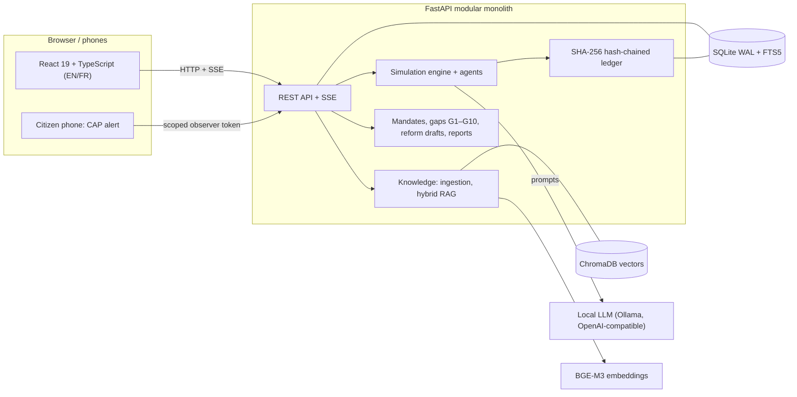

# ALERTE — Practising the crisis before it happens

> **AI for Good Sandbox Hackathon — United Arab Emirates 2026 (ITU)**
> A crisis drill played by AI agents that stand in for a country's real institutions. They act only within their legal mandates, cite the article behind every decision, and reveal the **policy gaps** (missing, unclear or conflicting rules) **before** a real disaster does.

| | |
|---|---|
| **Team** | *[team name — to complete]* |
| **Team leader / members** | *[to complete]* |
| **Repository** | https://github.com/RudyTchamba/ALERTE |
| **Code** | [`alerte-platform/`](alerte-platform/) (FastAPI backend + React frontend) |
| **Technical documentation** | [`alerte-platform/README.md`](alerte-platform/README.md) (French) · [architecture dossier](alerte-platform/docs/architecture/README.md) |
| **Knowledge base** | real national corpus, exportable as a portable archive (see [Knowledge base](#4-how-alerte-meets-the-five-evaluation-criteria)) |

All scenarios are **fictional** and say so on every screen. ALERTE is not a forecasting model, not a real alert system and not a chatbot.

---

## Contents

1. [The problem](#1-the-problem)
2. [Our solution, and how it closes the gaps of existing solutions](#2-our-solution)
3. [What role does AI play?](#3-what-role-does-ai-play)
4. [How ALERTE meets the five evaluation criteria](#4-how-alerte-meets-the-five-evaluation-criteria)
5. [Use case requirements, per Y.3172 node](#5-use-case-requirements-per-itu-t-y3172-node)
6. [Mapping with ITU-T Y.3172, AI Readiness 2.0 and domain policies](#6-mapping-with-itu-t-y3172-ai-readiness-report-20-and-domain-policies)
7. [Error scenarios and measured results](#7-error-scenarios-and-measured-results)
8. [Policy gaps and standards gaps](#8-policy-gaps-and-standards-gaps)
9. [The demo in three minutes](#9-the-demo-in-three-minutes)
10. [Architecture](#10-architecture)
11. [Quick start](#11-quick-start)
12. [Validation status and known limits](#12-validation-status-and-known-limits)
13. [Licence and attribution](#13-licence-and-attribution)

---

## 1. The problem

Forecasts fail, even in well-equipped countries. In April 2024 the UAE recorded its heaviest rainfall since records began in 1949. In 2024, floods in Cameroon's Far North affected about 410,000 people, flooded 262 schools and 65 health centres, and were followed by cholera. The UN **Early Warnings for All** initiative aims at universal coverage by 2027, and AI is entering the alert chain (forecasting, targeting, drafting and translating messages).

When a warning system errs — traditional or AI — the forecast is no longer the problem. What matters is how fast institutions respond and **what the law allows them to do**. And this is where the rules are often unclear:

* Who may order the phone operators to alert everyone, if the official warning never arrived?
* Who must check an AI-drafted message before it is sent?
* Who answers for the harm of a false alarm, or of a missed one?

A false alert in Hawaii (2018) took 38 minutes to correct. A missed alert costs lives. **These missing rules are usually discovered during a real disaster, when it is too late.** ALERTE finds them before — safely, quickly and at low cost.

## 2. Our solution

ALERTE is a **multi-agent crisis-exercise engine**. Each institution of a country (weather service, civil protection, governor, health ministry, telecom regulator, operators, municipality…) is a **seat** held by an AI agent or by a human.

1. **Choose a country.** Its real laws, decrees and plans are ingested into a vectorised knowledge base; its institutions and their documented mandates are registered, each with its source article.
2. **Events arrive step by step,** each one only to the institutions that would really receive it (uneven, incomplete information; private inboxes).
3. **Each agent decides within its mandate,** searching only the documents it is granted, and must cite the article behind every decision. Citations are **checked character by character** by deterministic code; an unsupported decision is recorded as *not verified*. When no text covers the situation, the agent must say **"no legal basis found"** instead of inventing one.
4. **Agents coordinate** on a board (INFO, REQUEST, DECISION, OBJECTION, GAP_FLAG) and can object to each other.
5. **Gaps are detected by explicit rules (G1–G10)** on the mandate registry, the scenario and the interactions, each with its chain of evidence, then **validated by humans**.
6. **From gap to fix:** ALERTE drafts a **reform article** for a gap, grounded in cited national texts, anchored in the exercise ledger and **publicly verifiable by QR code**. *What if…?* replays the exercise with the reform applied to check that the gap closes.
7. **The public's phone rings:** during the drill, any phone that scans a QR code receives a **CAP 1.2 alert (ITU-T X.1303, `status=Exercise`)** — or stays silent, because no institution was legally empowered to alert in time. The delay is measured.

Every step is written to a **SHA-256 hash-chained ledger** (tamper-evident) that can be verified and replayed without calling the AI.

**One engine, several countries.** Only the laws and institutions change, so countries can be compared side by side. The current release ships a complete **Cameroon** case (real corpus, 8 institutions, Far North flood of October 2024) and a small fictional demo country.

### How ALERTE closes the gaps of existing solutions

| Existing solution | Gap | How ALERTE solves it |
|---|---|---|
| Manual tabletop exercises and after-action reviews | Slow, costly, rare; findings rest on memory and opinion; institutions may hide weak points | A full exercise runs in minutes on one laptop; every finding cites the article **or the missing article**; runs are replayable and repeatable; AI agents have no reputation to protect |
| AI early-warning and EW4All tooling | Focus on forecasting and dissemination technology; do not test who is responsible when the system fails | The warning system fails on cue; agents must decide and justify under their real mandates; the public-alert delay is measured |
| Generic LLM / legal chatbots | One agent knowing everything; invented articles; no mandates, no uneven information, no audit trail | Private inboxes, mandate-scoped retrieval, deterministic citation check, "no legal basis found" rule, hash-chained ledger |
| ITU AI Readiness reference simulation | Scores readiness dimensions; legal considerations out of scope; agents assess, they do not play institutions | Plays institutions under their legal mandates, finds gaps by rule, drafts verifiable reforms, and reports a 13-dimension readiness scorecard |

## 3. What role does AI play?

| AI does | Deterministic code does (never the model) |
|---|---|
| Plays each institution: reads its inbox, searches its granted documents, asks the Legal Adviser, coordinates, decides | Drives the activation loop (≤ 4 steps per activation, one retry, deterministic fallback) |
| Writes the decision, its rationale and its citations in the exercise language | **Checks every citation** against the stored text (chunk, article, exact quote of ≥ 20 characters) |
| Drafts a reform article for a confirmed gap | Extracts the quoted text itself, rejects citations that do not resolve, hashes and anchors the draft in the ledger |
| Multilingual embeddings (BGE-M3) for hybrid search | Scopes retrieval to the agent's granted knowledge bases; detects gaps with rules G1–G10; builds the CAP alert |

**Local and sovereign by design:** the reference setup runs entirely on one machine with open-weight models served by Ollama (`qwen2.5:7b-instruct` for generation, `bge-m3` for embeddings). No national document leaves the country. Any OpenAI-compatible server can be plugged in per agent. The accuracy of the model is not what ALERTE sells: it sells **the method, the traceability and the quality of the gaps**.

## 4. How ALERTE meets the five evaluation criteria

| Criterion | What ALERTE provides | Where to see it |
|---|---|---|
| **C1 — Knowledge base quality** | Ingestion of PDF/DOCX/MD/TXT/CSV with OCR; chunking **by article** with page, section, language, licence, validity and evidence tag; extraction-quality report; immutable versions; hybrid search (SQLite FTS5 + BGE-M3 vectors in ChromaDB); export/import as a portable archive (ZIP + manifest + SHA-256, redistribution rights checked). Current workspace: **44 documents, 2,764 chunks** in 3 knowledge bases | *Knowledge bases* screen; `alerte-platform/backend/app/knowledge/` |
| **C2 — Agent capability** | Mandate-bounded agents with 4 tools (`search_kb`, `ask_legal`, `post`, `decide`); progressive, uneven injects; injected failures (over-confident AI, silent institution, disinformation, model unavailable); language guard; human seats on phones | *Simulation room*, decision traces |
| **C3 — Gap identification** | 10 explicit rules (orphan responsibility, overlapping mandates, missing procedure, missing human oversight of AI, liability, inclusion, …) with evidence chains, domains, global precedents, severity, confidence and **human validation**; counterfactual *What if…?*; **verifiable reform drafts** | *Gaps* screen, *What if…?*, `/verify/<sha256>` |
| **C4 — Auditability** | SHA-256 hash-chained ledger of every event, retrieval, model call, message, decision, citation check and gap; one-click integrity check; replay of what each seat knew; public verification of reform drafts by QR code | *Audit & replay* screen |
| **C5 — ITU alignment** | Node-by-node mapping to **ITU-T Y.3172**; 13-dimension **AI Readiness 2.0** scorecard; **CAP / ITU-T X.1303** public alerts; ITU vocabulary in the interface | *Architecture* and *Evaluation* screens; section 6 below |

## 5. Use case requirements, per ITU-T Y.3172 node

*"It is required that…"* applies to every line.

| Node | Requirement |
|---|---|
| **MLFO** (orchestrator) | An exercise starts from one frozen configuration (snapshot with SHA-256): country, scenario, seats (AI or human), AI mode (`ai`, `scripted`, `cassette` — the last two labelled **WITHOUT AI** everywhere). Model calls are budgeted and logged. |
| **SRC** | One corpus per country with provenance, licence and validity per document; fictional scenario injects; no real personal data. |
| **C** (collector) | Documents are collected through the knowledge-base pipeline; injects are released on a simulated clock to named recipients only. A missing document is shown as missing, never replaced by guesswork. |
| **PP** (preprocessor) | Laws are cut by article; each chunk carries country, document, article, language (FR/EN/AR), page and evidence tag; multilingual embeddings; OCR for scans. |
| **M** (model) | Each agent has a role card (institution, documented mandate with sources), a private inbox and four tools; every decision is a structured record (action, outcome, legal basis, confidence, options considered, evidence tag). |
| **P** (policy) | Retrieval is scoped to granted bases; every citation is checked; unsupported decisions are *not verified*; gaps are raised by rule and confirmed by humans; documents are data, never instructions (prompt-injection guard). |
| **D** (distributor) | Agents talk only through the coordination board (5 message types); no agent reads another agent's inbox. |
| **SINK** | Web interface (EN/FR, dark/light, accessible): live room, gap report, decision timeline, readiness scorecard, replay with "verify ledger", presentation mode, citizen phone alert, versioned reports (MD, JSON, CSV, XLSX, PDF). |
| **ML sandbox** | The whole simulator is the sandbox in which AI-assisted alerting is tested before any real deployment; every run can be replayed without the AI. |

## 6. Mapping with ITU-T Y.3172, AI Readiness Report 2.0 and domain policies

| Node | ALERTE component | Readiness 2.0 dimensions | Documents (examples) |
|---|---|---|---|
| **SRC** | National laws, decrees, plans; global precedents; ITU texts; scenario injects | D1 Data/model marketplace (provenance, licences); D4 Contextualisation | CM Law 86-016 (civil protection), Decree 98-031 (emergency plans), Law 2010-013 (electronic communications), National Contingency Plan; IFRC IDRL mapping of Cameroon (2021) |
| **C** | Ingestion pipeline; inject engine (simulated clock, named recipients) | D1 metadata and provenance; D3 Cross-domain correlation | ITU AI Readiness Report 2.0; UNICEF flood flash update (realism of injects) |
| **PP** | Article-level chunking, metadata, evidence tags, BGE-M3, OCR | D1 standard formats; D11 AI for inclusion (languages) | ITU-T X.1303 (CAP) |
| **M** | Institution agents, Legal Adviser, AI system under test | D5 AI in workflows; D2 Generated content; D8 Collaboration with AI | National AI strategies; EU AI Act; NIST AI RMF |
| **P** | Mandate registry, citation check, gap rules G1–G10, "no legal basis found" | D10 AI and policies; D7 Strategy alignment; D8 Human in the loop | EU Electronic Communications Code Art. 110; Philippines RA 10639; US 47 CFR Part 10; FCC Hawaii false-alert report |
| **D** | Coordination board and inbox router | D7 Strategy alignment; D3 Cross-domain | Mauritius CAP; Japan J-Alert; ITU Guidelines for National Emergency Telecommunication Plans |
| **SINK** | Interface, reports, citizen CAP alert, verifiable reform page | D6 Human interface; D9 Humans in AI integration; D11 Inclusion | Early Warnings for All Executive Action Plan 2023-2027; Sendai Framework |
| **MLFO** | Exercise orchestrator, model gateway with local fallback, ledger | D12 Granular priorities; D13 Digital infrastructure and energy | ITU-T Y.3172 |
| **ML sandbox** | The simulator itself; fictional, labelled scenarios | D10 AI for policies (sandboxes) | ITU AI for Good Sandbox |

The Y.3172 nodes were checked against the text of the Recommendation and the 13 Readiness dimensions against the ITU report: see [hackathon conformance](alerte-platform/docs/architecture/03-hackathon-conformance.md).

## 7. Error scenarios and measured results

**Scenario "Far North flood (October 2024)" — Cameroon, real corpus, AI mode.** Injects arrive progressively to chosen institutions: heavy rain and a river rising at dawn, a failing warning chain, displaced families, cholera in the camps, fake alerts online. Each inject tests one responsibility.

| Step | What happens | How ALERTE handles it | Gap revealed |
|---|---|---|---|
| 1 | J1 06:00 — the Logone rises, dykes threatened | The governor triggers the emergency plan citing **Decree 98/031, art. 3**; nobody is bound to issue a precautionary flood warning | Orphan responsibility (G1) |
| 2 | The governor tries to issue a public alert | Its citation does not resolve against the stored text → decision **not verified**, alert **blocked** | Missing procedure (G3) |
| 3 | Operators finally relay an alert at J1 10:00 | The citizen phone rings; the CAP 1.2 alert shows the issuer and the **4-hour delay** | No deadline for public alerting (G3) |
| 4 | Cholera spreads in displacement sites | Health ministry acts under its specific response plan; coordination requests are tracked | Liability (G6), inclusion (G7) |
| 5 | Fake alerts circulate online | Regulator and ICT agency look for a power to block and correct | Missing procedure and liability (G3, G6) |

**Measured on exercise EX-022** (AI mode, `qwen2.5:7b-instruct` + `bge-m3`, local Ollama, one laptop), after a corpus audit:

* **The audit mattered.** The prototype's file for Decree 98/031 (organisation of emergency plans) actually contained another report; with the real decree, the run EX-019 → EX-022 lost **2 false gaps** (the municipality no longer appears as an orphan holder of the alert) and **kept 16**. The governor and civil protection now ground their decisions in **Decree 98/031, art. 3**.
* **16 candidate gaps** (8 of severity 3) awaiting human review. The headline gap is sharper and better founded: *"Orphan responsibility: issue a flood warning"*. Art. 3 provides for "the dissemination of the alert", but only once the emergency plan is triggered on "reliable information leaving no doubt": **no text frames an early warning while a flood is only a threat, nor its deadline.**
* Public alert issued **4 h after the crisis began**; a later attempt was blocked for lack of a verified legal basis.
* 0 agent outputs in the wrong language after the language guard.
* A **reform draft** for the flood-warning gap, verified with 3 resolving citations (Decree 98/031 art. 3, Law 86/016 art. 1 and art. 7): *"The Civil Protection Directorate (MINAT) shall issue a flood warning … within one hour of detecting a major flood risk."* Publicly checkable at `/verify/<sha256>`.
* Retrieval was tuned on this evidence: official texts outrank secondary summaries at equal relevance, a small crisis-vocabulary thesaurus links agents' words ("ORSEC", "flood") to legal wording ("emergency plan", "major risk"), and agents read 8 results per search.

**Where the solution may face controversy, and how it responds.** AI inventing law → the citation check rejects it. Missing or summarised texts → every answer carries an evidence tag (documented / inferred / assumed), and absence of evidence is never reported as evidence of absence unless a human declared the mandate registry complete. Perceived criticism of a government → fictional scenarios, institutions never individuals, gaps framed as opportunities. Humans disagreeing with the AI → any seat can be taken over by a person from a phone, and all gaps require human validation.

## 8. Policy gaps and standards gaps

Gaps are stated **for the domain** (public alerting), with evidence from national texts and examples from other jurisdictions. They are candidates until confirmed by expert review.

| Policy gap | Evidence in the texts checked | Global examples | What would need to change in any country with the same gap |
|---|---|---|---|
| No authority clearly bound to issue the public flood warning (G1) | Cameroon: alerting covered only indirectly (IFRC mapping 2021, Decree 98-031); confirmed in exercise | EU Code Art. 110; Philippines RA 10639; US 47 CFR Part 10 | Name the issuing authority, with a deadline |
| Operators have no explicit duty to relay alerts (G1) | No duty found in the electronic-communications law | Same as above; Mauritius CAP | Operator duties: deadline, cost, liability |
| No check before an AI-drafted alert is released (G3, G8) | No procedure, deadline or validity condition found | Hawaii 2018 (one-person release, 38 min to correct); EU AI Act human oversight | Human validation step with logged approval |
| No language and coverage duty (G7) | No language or accessibility duty found | EW4All dissemination pillar; CAP multilingual alerts | Alerts in the languages spoken, plus radio and sirens |
| Alert channel not protected from spoofing (G9) | No explicit alert-channel duty in the cybersecurity law | US alert origination rules; Hawaii correction procedure | Name who may block and correct fake alerts |
| Nobody answers for the harm of a false or missed alert (G6) | No liability allocation found for AI outputs used by the state | EU AI Act provider/deployer duties | Allocate liability between vendor, operator and authority |

**Standards gaps (proposals for ITU study groups).**
1. **Y.3172 policy node for public services:** no guidance on expressing legal mandates, human approval and logging in the P node.
2. **Declared validity conditions:** no standard requires a model to state the minimum inputs it needs (e.g. 5 of 7 river sensors) and to flag when they are unmet.
3. **Alert provenance in CAP (X.1303):** no common profile marks AI-generated content or human validation.
4. **Readiness metrics:** Report 2.0 has no metric for the clarity of institutional mandates or of liability in AI-assisted alerting (could be added under D10).
5. **Agent audit records:** no common format for reasoning traces and source attribution of AI agents in public services — ALERTE's decision record and hash-chained ledger are a candidate.

## 9. The demo in three minutes

1. **Home dashboard** — key figures and the outcome of the latest exercise (alert delay, gaps by severity).
2. **Simulation room** — replay EX-022: injects arrive, agents search, cite, coordinate; one citation is rejected live.
3. **"Alert residents"** — the jury scans the QR code; their phone stays silent… then rings with a CAP alert 4 hours (simulated) after the crisis.
4. **Gaps** — open *"Orphan responsibility: issue a flood warning"*, its evidence chain, then **"AI reform draft"** → print → scan the QR code → *Authentic and intact document*.
5. **Audit** — "Verify ledger": every event chained; tamper one row and the break is pinpointed.

## 10. Architecture



Modules: `workspaces`, `audit`, `knowledge`, `mandates`, `agents`, `scenarios`, `simulation`, `gaps`, `evaluation`, `reports` — boundaries enforced by an architecture test. Security: hashed bearer tokens, roles (owner, facilitator, player, observer, auditor), observer tokens scoped to one exercise, secrets masked in logs.

## 11. Quick start

Requirements: Python 3.11+ (3.12 recommended), Node.js 22, and optionally [Ollama](https://ollama.com) for real AI.

```bash
git clone https://github.com/RudyTchamba/ALERTE.git
cd ALERTE/alerte-platform
python3 scripts/setup.py          # creates backend/.venv, installs dependencies, copies .env.example to backend/.env, npm ci
python3 scripts/doctor.py         # checks versions, model servers, OCR

# Real AI (optional): local open-weight models
ollama pull qwen2.5:7b-instruct && ollama pull bge-m3
# then in backend/.env:
#   ALERTE_EMBED_BASE_URL=http://localhost:11434/v1   ALERTE_EMBED_MODEL=bge-m3
#   ALERTE_LLM_BASE_URL=http://localhost:11434/v1     ALERTE_LLM_MODEL=qwen2.5:7b-instruct

python3 scripts/dev.py            # backend :8000 + frontend :5173 (add --host to reach phones on the LAN)
```

Open http://localhost:5173/access and create a workspace (the owner token is shown once). To get a ready-made workspace: `cd backend && .venv/bin/python scripts/seed_demo.py` (fictional demo country), or `scripts/seed_cameroon.py` (Cameroon case). API docs: http://localhost:8000/api/v1/docs.

Tests:

```bash
cd alerte-platform/backend && .venv/bin/python -m pytest -m "not model and not gpu"
cd alerte-platform/frontend && npm run typecheck && npm run lint && npm test && npm run build
```

## 12. Validation status and known limits

* **Tests:** 533 backend tests (pytest, all passing), 80 frontend tests (Vitest), typecheck, lint and production build passing.
* **Signatures:** ledger anchors and knowledge-base archives are signed with the instance's Ed25519 key (public key at `/api/v1/ledger/public-key`); a forged archive signature is rejected on import.
* **AI scorecard judge:** proposes an answer per AI Readiness criterion from verifiable exercise facts only (never the gaps), with checked references; answers stay *to review* until a human validates them.
* **Proven with real models:** hybrid retrieval with BGE-M3; full AI exercises on the Cameroon corpus with `qwen2.5:7b-instruct` (tool use, citation check, language guard, gap detection, verified reform draft).
* **Not claimed:** the legal correctness of gaps — they are **candidates for expert review**, by design. Reasoning quality of larger models (14B+) was not benchmarked. Gap detection is rule-based and identical in `scripted` and `ai` modes.
* **Known limits:** UAE corpus documented but no UAE exercise run in this release; some backend messages are in French only; the multi-OS CI is written but not yet run; no Dockerfile (Docker is never required).

Full feature-by-feature status: [alerte-platform/README.md § 18](alerte-platform/README.md#18-état-réel-de-validation).

## 13. Licence and attribution

*Licence: to be confirmed by the team before submission (MIT planned; no LICENSE file yet).* Dependencies are open source; PyMuPDF (AGPL) is deliberately excluded. The 13 Readiness dimensions come from the ITU *AI Ready — Report 2.0*; ideas from the ITU-cited reference repository `CrashingGuru/ITUAIReadiness` (MIT) are credited in [A9](alerte-platform/docs/architecture/appendix/A9-itu-reference-code-study.md). National legal texts remain the property of their publishers; only documents whose redistribution is allowed are exported in the open knowledge-base archive.
