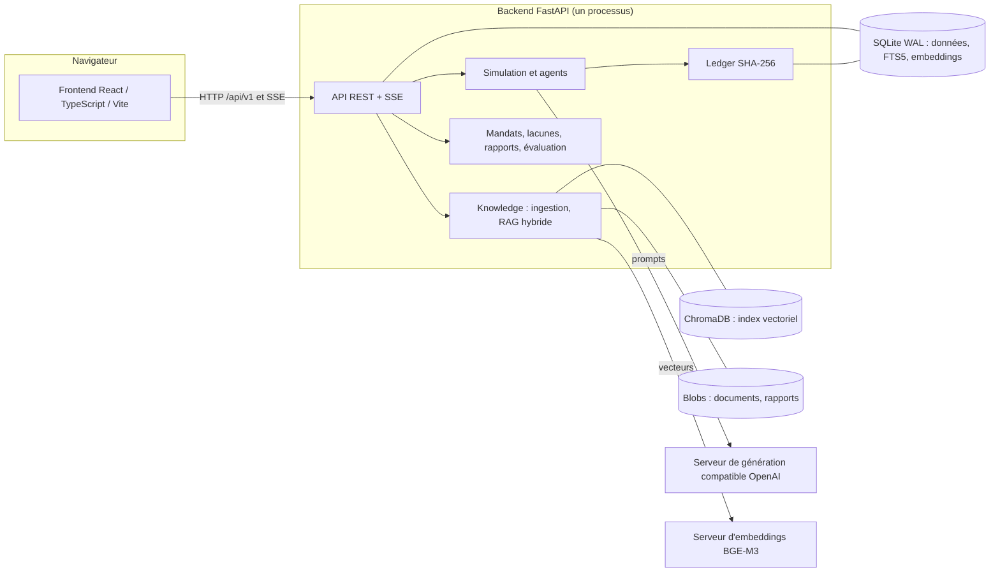

# ALERTE Platform

Plateforme **générique** de simulation d'exercices de crise multi-agents. Des agents IA (ou des humains) jouent les **institutions réelles** d'un pays, chacune
bornée par ses **mandats** et par les **documents** auxquels elle a légitimement accès. Les **lacunes institutionnelles** (responsabilité orpheline,
chevauchement de mandats, procédure absente, absence de supervision humaine de l'IA…) **émergent** des documents, du registre de mandats, des événements
du scénario, des interactions et de règles explicites — puis sont **validées par des humains** et publiées en rapports.

Projet développé pour l'« AI for Good Sandbox / Lab Hackathon — UAE 2026 » (UIT). L'application est **indépendante du Sandbox** : tout (import de documents,
bases de connaissances, RAG, agents, scénarios, simulation, lacunes, rapports, export) fonctionne en local ; le Sandbox n'est qu'une cible de déploiement.

## Sommaire

1. [Présentation et objectifs](#1-présentation-et-objectifs) · 2. [Problématique](#2-problématique-des-lacunes-institutionnelles) · 3. [Système multi-agents](#3-fonctionnement-du-système-multi-agents) · 4. [Architecture](#4-architecture-technique-générale) · 5. [Technologies](#5-technologies) · 6. [Prérequis](#6-prérequis) · 7. [Arborescence](#7-arborescence) · 8. [Installation](#8-installation-complète) · 9. [Configuration](#9-configuration) · 10. [Démarrage](#10-démarrage-du-backend-et-du-frontend) · 11. [Accès](#11-accès-à-lapplication) · 12. [Parcours](#12-parcours-utilisateur) · 13. [Modèles IA](#13-configuration-des-modèles-ia) · 14. [Bases de connaissances](#14-gestion-des-bases-de-connaissances) · 15. [Tests](#15-tests) · 16. [Déploiement](#16-déploiement) · 17. [Dépannage](#17-dépannage) · [18. État de validation](#18-état-réel-de-validation)

Documentation détaillée : [backend/README.md](backend/README.md) · [frontend/README.md](frontend/README.md) · [architecture](docs/architecture/README.md) · [contrats entre modules](backend/CONTRACTS.md).

## 1. Présentation et objectifs

* Construire, depuis l'interface, un **exercice de crise** : pays → institutions → mandats → bases de connaissances → agents → scénario → exercice.
* **Jouer** l'exercice : chaque siège (institution) est tenu par un agent IA ou par un humain ; chaque décision doit citer des sources **vérifiées** par un contrôle déterministe.
* **Détecter** les lacunes avec des règles explicites, des preuves (mandat, texte, événement, recherche négative) et une **validation humaine**.
* **Rendre compte** : rapports versionnés immuables (MD, JSON, CSV, XLSX, PDF), journal d'audit chaîné, mesures de qualité (T1–T6) et scorecard AI Readiness (13 dimensions).
* **Réutiliser** : bases de connaissances exportables/réimportables (archive ZIP + manifeste + SHA-256, contrôle des droits de redistribution).

## 2. Problématique des lacunes institutionnelles

Une crise (inondation, cyberattaque, défaillance d'un système d'IA…) mobilise plusieurs institutions dont les mandats, textes et procédures ne sont jamais
testés ensemble. ALERTE les fait « jouer » sur la base de leurs seuls documents : quand **personne** n'a de mandat documenté pour une action requise,
quand deux institutions peuvent agir sans chef de file, quand une procédure n'est pas spécifiée, la lacune est **observable** et **traçable** jusqu'à ses preuves.

Garde-fous d'indépendance de la détection : une absence n'est affirmée que si le **registre de mandats a été déclaré complet par un humain** (non revu ≠ mandat absent) ;
chaque action demandée porte sa **dérivation** (référentiel, auteur du scénario, proposée par un agent) ; les signaux issus de fournisseurs `scripted` ne sont jamais
présentés comme « observés » ; l'hypothèse d'un agent seule n'est jamais un constat ; la recherche négative peut **rétrograder** une lacune.

## 3. Fonctionnement du système multi-agents

Boucle d'activation **pilotée par le backend** (jamais par le modèle) : à chaque inject, chaque siège destinataire est activé (≤ 4 étapes, 1 nouvelle tentative, repli déterministe) et choisit parmi **quatre outils** :

| Outil | Rôle |
|---|---|
| `search_kb` | recherche hybride dans les seules bases accordées à l'agent (périmètre fixé par le backend) |
| `ask_legal` | question au conseiller juridique (réponse structurée, citations vérifiées) |
| `post` | message au tableau de coordination (INFO, REQUEST, DECISION, OBJECTION, GAP_FLAG) |
| `decide` | décision avec **base légale** : chaque citation `{chunk, article, extrait}` est contrôlée contre le texte réel |

Le moteur de coordination (code déterministe) émet des **signaux** (demande orpheline, sans propriétaire, chevauchement, décisions contradictoires, sans réponse…)
qui nourrissent — sans la remplacer — la détection de lacunes. Tout est consigné dans un **ledger SHA-256 chaîné** (honnêteté : *tamper-evident*, pas infalsifiable).

## 4. Architecture technique générale



Monolithe modulaire (modules `workspaces`, `audit`, `knowledge`, `mandates`, `agents`, `scenarios`, `simulation`, `gaps`, `evaluation`, `reports`), SQLite (WAL) comme source de vérité,
flux SSE lus depuis le ledger par numéro de séquence (reprise après coupure). Les serveurs de **génération** et d'**embeddings** sont configurables **indépendamment** et peuvent tourner sur
une autre machine : le même code s'exécute sur un poste de développement, une machine d'équipe ou le Sandbox.

## 5. Technologies

| Couche | Technologies |
|---|---|
| Backend | Python 3.12, FastAPI, Pydantic 2, SQLAlchemy 2, Alembic, SQLite (WAL, FTS5), ChromaDB, pdfplumber/pypdfium2, Tesseract, WeasyPrint, openpyxl |
| IA | modèles servis via API compatible OpenAI (Ollama, vLLM, TEI…) ; embeddings BGE-M3 |
| Frontend | React 19, TypeScript 5.9, Vite 8, Tailwind CSS 4, TanStack Query, React Router 7 |
| Qualité | pytest (515 tests), Vitest (54 tests), ruff, oxlint, axe-core, GitHub Actions (ubuntu/windows/macos — écrite, non encore exécutée) |

Licences : dépendances open source ; **PyMuPDF (AGPL) est exclu**.

## 6. Prérequis

| Outil | Version | Obligatoire |
|---|---|---|
| Python | 3.11+ (3.12 recommandé) | oui |
| Node.js | 22 (via nvm : `.nvmrc`) | oui (frontend) |
| Git | — | oui |
| Tesseract + `fra`, `ara`, `eng` | 5.x | non (OCR des scans) |
| Pango | — | non (PDF WeasyPrint ; repli prévu) |
| Serveur d'embeddings BGE-M3 | — | recommandé (recherche hybride réelle) ; sinon recherche lexicale dégradée |
| Serveur de génération | API OpenAI-compatible | pour les agents « réels » ; sinon exercices `scripted` (SANS IA) |
| Docker / Podman | — | **optionnel** (jamais requis) |

Aucune contrainte de puissance : les modèles tournent sur le serveur de votre choix. Ne jamais utiliser `sudo pip` ni `sudo npm`.

## 7. Arborescence

```
alerte-platform/
  README.md                 ce fichier
  .env.example              modèle de configuration (copié en backend/.env)
  .nvmrc                    Node 22
  backend/                  API FastAPI  → backend/README.md
    app/  migrations/  tests/  scripts/  requirements*.txt  .venv/ (local)
  frontend/                 interface React → frontend/README.md
    src/  package.json  package-lock.json  .nvmrc
  scripts/                  setup.py, doctor.py, dev.py (multiplateforme)
  docs/
    architecture/           dossier d'architecture (15 documents + annexes)
    runbooks/               procédures (installation, frontend)
  .github/workflows/ci.yml  CI multi-OS
```

## 8. Installation complète

```bash
git clone <dépôt> && cd <dépôt>/alerte-platform
python3 scripts/setup.py            # crée backend/.venv, installe les dépendances, copie .env.example → backend/.env, npm ci
python3 scripts/doctor.py           # diagnostic : versions, dépendances, serveurs de modèles, OCR…
```

Équivalent manuel (Ubuntu/macOS) :

```bash
cd backend && python3 -m venv .venv && source .venv/bin/activate
python -m pip install --upgrade pip && python -m pip install -r requirements-dev.txt
cp -n ../.env.example .env            # -n : n'écrase jamais un .env existant
cd ../frontend && nvm use && npm ci
```

Windows PowerShell : voir [backend/README.md](backend/README.md#2-environnement-virtuel-dédié) (`py -m venv .venv`, `.\.venv\Scripts\Activate.ps1`).

## 9. Configuration

Un seul fichier : `backend/.env` (ignoré par Git), variables `ALERTE_*` — table complète dans [backend/README.md](backend/README.md#3-configuration-backendenv).
Les deux variables essentielles pour l'IA réelle :

```ini
ALERTE_EMBED_BASE_URL=http://localhost:11434/v1     # serveur d'embeddings (ex. Ollama + bge-m3)
ALERTE_EMBED_MODEL=bge-m3
ALERTE_LLM_BASE_URL=http://machine-equipe:8000/v1   # serveur de génération
ALERTE_LLM_MODEL=<nom du modèle>
```

Côté frontend : aucune configuration en développement (proxy `/api` → `localhost:8000`) ; `ALERTE_API_URL` pour changer la cible.

## 10. Démarrage du backend et du frontend

Deux terminaux distincts.

**Terminal 1 — backend** (depuis `alerte-platform/backend`, venv activé) :

```bash
cd alerte-platform/backend
source .venv/bin/activate            # Windows : .\.venv\Scripts\Activate.ps1
python -m uvicorn app.main:app_factory --factory --reload --port 8000
```

Le premier démarrage crée `backend/data/` et applique les migrations (`schéma=alembic` dans le journal).

**Terminal 2 — frontend** (depuis `alerte-platform/frontend`) :

```bash
cd alerte-platform/frontend
nvm use                              # Node 22 (si nvm est présent)
npm run dev
```

**Arrêt propre** : `Ctrl+C` dans chaque terminal (uvicorn termine ses requêtes en cours ; les jobs actifs passent à `interrupted` et sont signalés au prochain démarrage).
Option tout-en-un : `python3 scripts/dev.py` lance les deux et les arrête ensemble avec `Ctrl+C`.

Mode « un seul processus » : `cd frontend && npm run build`, puis le backend sert aussi l'interface sur `http://localhost:8000/`.

## 11. Accès à l'application

| URL | Contenu |
|---|---|
| `http://localhost:5173` | **interface** (développement) |
| `http://localhost:5173/access` | création d'un espace / saisie d'un jeton |
| `http://localhost:8000/api/v1/docs` | Swagger UI |
| `http://localhost:8000/api/v1/redoc` | ReDoc |
| `http://localhost:8000/api/v1/health` · `/ready` | vivacité · disponibilité (base, FTS5, embedder) |

Premier usage : sur `/access`, « créer un espace » → copiez le **jeton propriétaire** (affiché une seule fois ; seul son hash est conservé). Pour explorer une interface déjà remplie :
backend démarré, `cd backend && python scripts/seed_demo.py` crée un espace fictif « Démo ALERTE » complet (données fictives, exercice `scripted` SANS IA) et affiche son jeton.

## 12. Parcours utilisateur

| Étape | Écran | Ce que fait l'utilisateur |
|---|---|---|
| 1 | Countries & institutions | crée pays, institutions, catalogue d'actions, **mandats** (chacun lié à une source documentaire) ; déclare la **revue du registre** |
| 2 | Knowledge bases | crée une KB, importe des documents (PDF, DOCX, MD, TXT, CSV ; OCR si scan), suit l'ingestion (SSE), contrôle la qualité, publie une version, exporte/importe |
| 3 | Agents / Knowledge access | crée les agents (mission, outils, limites, profil de modèle) ; règle la **matrice d'accès** agents × bases |
| 4 | Scenarios | construit le scénario : injects, destinataires, demandes (actions), modes de panne ; lint |
| 5 | Exercises | crée l'exercice, attribue les sièges (agent ou humain), vérifie la **préparation** (readiness), lance |
| 6 | Simulation Room | suit l'exercice en direct (SSE), tableau de coordination, décisions et traces ; sièges humains via liens personnels |
| 7 | Gap analysis | examine chaque lacune et sa chaîne de preuves, la confirme ou la rejette (revue humaine) |
| 8 | Reports | génère un rapport versionné, le publie, l'exporte (MD/JSON/CSV/XLSX/PDF), compare des versions ou des exercices, importe des rapports existants |
| 9 | Audit & replay · Evaluation | vérifie l'intégrité du ledger, rejoue ce que chaque siège savait ; mesures T1–T6 et scorecard |

## 13. Configuration des modèles IA

* **Embeddings** (BGE-M3, recommandé) : `ollama pull bge-m3`, puis `ALERTE_EMBED_BASE_URL=http://localhost:11434/v1`, `ALERTE_EMBED_MODEL=bge-m3`. Vérifier : `/api/v1/ready`.
* **Génération** : tout serveur compatible OpenAI (`/v1/chat/completions`) ; configurez `ALERTE_LLM_BASE_URL`/`ALERTE_LLM_MODEL` (défaut) ou créez des **profils de modèle** par agent (écran Agents ; le profil référence un *nom de variable*, jamais une URL ni une clé).
* **Mode de l'exercice** : `ai` (vrai modèle), `scripted` ou `cassette` (**SANS IA**, étiquetés partout : bandeau, rapport, ledger).
* Les serveurs peuvent être sur **une autre machine** : seule l'URL change. Les clés d'API restent dans `.env`.

## 14. Gestion des bases de connaissances

Import → ingestion (extraction, découpage en chunks avec article/section/page, OCR si besoin) → indexation (FTS5 + vecteurs BGE-M3) → publication d'une **version immuable**.
Une KB s'exporte en archive portable (ZIP + manifeste + SHA-256) ; l'import est en deux temps (validation, confirmation) et refuse les contenus dont la redistribution n'est pas autorisée.
`backend/scripts/legacy_to_archive.py` convertit l'ancienne base du prototype `alerte/` (45 documents, 4 235 chunks) en archives importables.

## 15. Tests

```bash
cd backend && python -m pytest -m "not model and not gpu"            # 515 tests collectés, sans serveur de modèle
cd backend && ALERTE_EMBED_BASE_URL=http://localhost:11434/v1 ALERTE_EMBED_MODEL=bge-m3 python -m pytest -m model tests/knowledge   # embeddings RÉELS
cd frontend && npm run typecheck && npm run lint && npm test && npm run build
```

Les tests `scripted`/`fixture` prouvent l'**intégration** ; seuls les tests `-m model` exécutés avec de vrais modèles prouvent le fonctionnement de l'IA.

## 16. Déploiement

* **Local / machine d'équipe** : `npm run build` puis `python -m uvicorn app.main:app_factory --factory --host 0.0.0.0 --port 8000` (un processus sert API + interface). Placer derrière un proxy TLS pour toute exposition réseau.
* **Sandbox / serveur** : même code ; configurer `ALERTE_*`, `ALERTE_DATA_DIR` sur un volume persistant, serveurs de modèles accessibles. Docker/Podman sont facultatifs et **non requis** ; aucun Dockerfile n'est encore fourni.
* **Données** : sauvegarde = copie du dossier `ALERTE_DATA_DIR` (application arrêtée) ; ne jamais exposer `data/`.
* **Sécurité** : jetons porteurs hachés (SHA-256), rôles owner/facilitator/player/observer/auditor, CORS restreint, secrets masqués dans les journaux.

## 17. Dépannage

| Problème | Solution |
|---|---|
| `The server cannot be reached` (UI) | backend non démarré / mauvais port : `curl localhost:8000/api/v1/health` |
| Recherche « dégradée » | serveur d'embeddings non configuré ou injoignable (`/ready`) |
| Agents « Fallback (no model) » | exercice en mode `ai` sans serveur de génération configuré |
| `nvm: command not found` | `. ~/.nvm/nvm.sh` (nvm est une fonction du shell interactif) |
| `ModuleNotFoundError` | venv non activé : utiliser `backend/.venv/bin/python` |
| 401 en boucle | jeton révoqué ou expiré |
| OCR / PDF en échec | installer Tesseract (`fra`, `ara`) / Pango, ou voir `python3 scripts/doctor.py` |

Détails : sections « Problèmes courants » de [backend/README.md](backend/README.md#13-problèmes-courants) et « Dépannage » de [frontend/README.md](frontend/README.md#9-dépannage).

## 18. État réel de validation

Légende : **IMPL** implémenté · **FIX** testé avec fixtures/scripts (déterministe, **sans IA**) · **RÉEL** testé avec un vrai modèle · **—** non vérifié · **LIM** limite connue.
Mise à jour : 2026-11-21. Résultats mesurés : backend 515 tests collectés (suite complète : 513 réussis, 0 échec, 2 ignorés = les deux tests `-m model`, dont un seul a été exécuté à part : celui des embeddings) ; frontend 54 tests, typecheck, lint, build OK.

| Fonctionnalité | IMPL | FIX | RÉEL | Remarques |
|---|:-:|:-:|:-:|---|
| Espaces, jetons, rôles, pays, institutions | ✔ | ✔ | n/a | |
| Ledger chaîné, vérification, ancres, export | ✔ | ✔ | n/a | *tamper-evident*, pas infalsifiable |
| Import de documents TXT/PDF/OCR, découpage, qualité | ✔ | ✔ | n/a | OCR `fra`/`ara` : dépend des données Tesseract installées |
| Indexation lexicale FTS5 | ✔ | ✔ | n/a | |
| **Embeddings BGE-M3 + recherche hybride** | ✔ | ✔ | **✔** | `pytest -m model` : 1 test réussi via Ollama (FR + AR) ; indexation réelle 5/5 chunks de la démo. LIM : corpus minuscule, qualité de classement non mesurée |
| Périmètre de recherche strict (permissions) | ✔ | ✔ | n/a | tests de canaris, re-vérification SQL |
| Export / import de KB | ✔ | ✔ | n/a | pas de signature Ed25519 (prévu) |
| Mandats, actions, revue du registre | ✔ | ✔ | n/a | pas d'extraction de mandats par LLM |
| Agents : boucle, outils, citations vérifiées | ✔ | ✔ | **partiel** | un run réel avec `qwen2.5:1.5b-instruct` (Ollama) : chemin fournisseur, outils et garde-fous exécutés pour de vrai ; **qualité du raisonnement non validée** (voir ci-dessous) |
| Simulation, SSE, sièges humains, préparation | ✔ | ✔ | n/a | |
| Détection de lacunes (règles G1–G10) | ✔ | ✔ | n/a | seuils de recherche négative non calibrés sur de vrais scores |
| Rapports MD/JSON/CSV/XLSX/PDF, versions immuables | ✔ | ✔ | n/a | PDF : rendu vérifié (latin + arabe) |
| Évaluation T1–T6, scorecard | ✔ | ✔ | — | évaluation automatique LLM du scorecard : **501** (non implémentée) |
| Migrations Alembic | ✔ | ✔ | n/a | testé sur venv vierge |
| Frontend (17 routes) | ✔ | ✔ | n/a | contrôlé dans Chrome : aucune erreur console, axe sans violation, pas de débordement mobile sur les pages testées. Interface en anglais et français ; LIM : certains messages renvoyés par le backend restent en français |
| **Chaîne complète via HTTP** (démo) | ✔ | ✔ | partiel | `scripts/seed_demo.py` : embeddings réels, agents `scripted` |
| CI GitHub Actions 3 OS | ✔ | — | — | **jamais exécutée** ; Windows/macOS non vérifiés |

**Génération (agents) avec un vrai modèle — résultat du 2026-11-21.** Un exercice de démonstration (2 sièges, `ai_mode=ai`) a été joué de bout en bout avec **`qwen2.5:1.5b-instruct`** servi par Ollama sur la machine de développement (CPU seul, ≈ 60 s par appel) et **BGE-M3** réel pour la recherche :

* **Ce qui est prouvé** : le chemin « vrai fournisseur » fonctionne (10 appels modèle consignés avec modèle, jetons, durée ; budget compté) ; le modèle appelle l'outil `search_kb` et la **recherche hybride réelle** répond (signaux `dense` et `lexical` actifs, mode non dégradé) ; les sorties du modèle sont validées par le schéma, rejetées puis retentées quand elles sont invalides ; les garde-fous réagissent : décision **non enregistrée** pour le siège MET (sortie sans `legal_basis` après nouvelle tentative) et décision **non vérifiée** pour le siège DPC (citation refusée par le contrôle déterministe) ; l'exercice se termine, le ledger est cohérent, les lacunes et le rapport sont produits.
* **Ce qui n'est PAS prouvé** : la qualité du raisonnement des agents. Un modèle de 1,5 milliard de paramètres ne satisfait pas l'exigence de base légale citée mot pour mot ; ce résultat illustre le contrôle des citations, pas la valeur d'un modèle de production. Les modèles visés (7–14 B, p. ex. Qwen2.5-14B ou Mistral Nemo) n'ont **pas** été essayés : ils exigent une machine d'équipe ou le Sandbox. Le test automatisé `pytest -m model tests/agents` (20 activations, taux d'échec de schéma < 5 %) n'a **pas** pu être exécuté sur ce poste (trop lent) : il reste à lancer sur une machine adaptée.
* Les lacunes détectées sont indépendantes des décisions des agents (règles sur le registre et le scénario) : elles sont identiques en mode `scripted` et en mode `ai`.

**Limites connues** : aucune validation de la **qualité** du raisonnement des agents sur un modèle de production ; pas de machine d'équipe désignée pour les modèles de 7–14 B ;
messages du backend non traduits (français) ; pas de Dockerfile ; CI non exécutée ; Windows/macOS non testés.
