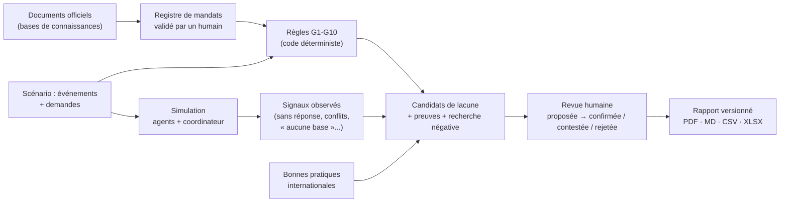
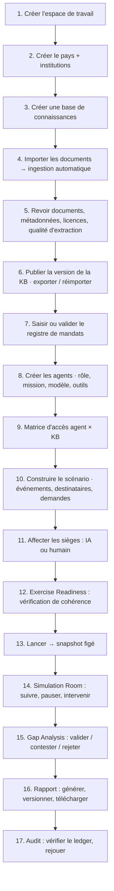

# 01 — Vision fonctionnelle et périmètre

## 1.1 Ce qu'est ALERTE

**ALERTE est une plateforme de simulation d'exercices de crise multi-agents. Elle fait apparaître les lacunes institutionnelles, réglementaires, organisationnelles et opérationnelles d'un pays, en confrontant les mandats documentés des institutions réelles à des événements qui arrivent progressivement.**

| ALERTE est | ALERTE n'est pas |
|---|---|
| Un banc d'essai où chaque institution est jouée par un agent IA (ou un humain) limité à son mandat et à ses sources | Un chatbot qui répond à des questions sur des lois |
| Un instrument d'analyse : les lacunes sont **déduites** de preuves (textes, mandats, comportements observés) | Un jeu où l'on demande aux agents de « retrouver » des lacunes écrites à l'avance |
| Un système auditable : chaque décision a ses sources, son contexte et son empreinte | Un système dont on doit croire le « raisonnement » |
| Une plateforme **générique** : le pays, les institutions, les documents et les scénarios sont des données saisies dans l'interface | Une application codée pour le Cameroun ou les Émirats |

## 1.2 Principe directeur : d'où viennent les lacunes

Une lacune n'existe dans ALERTE que si elle s'appuie sur au moins un élément qui **n'est pas** une simple affirmation d'un agent. Sept sources de preuves, combinées :

1. **Documents officiels** du pays (bases de connaissances, versions, citations à l'article).
2. **Responsabilités réelles** : le *registre de mandats* (qui détient quel pouvoir ou devoir, d'après quel texte).
3. **Événements injectés** par le scénario, qui *exigent* des actions (« demandes »).
4. **Comportements des agents** : décisions, refus, « pas notre rôle », « aucune base juridique trouvée ».
5. **Interactions** : demandes sans réponse, revendications croisées, décisions contradictoires (observées par le coordinateur déterministe).
6. **Règles explicites** G1–G10 (+ extensions), exécutées par du code, pas par un modèle.
7. **Bonnes pratiques internationales** : précédents sourcés, rattachés au domaine de la lacune.

Puis la **validation humaine** (confirmée / contestée / rejetée), historisée.

**Règles d'intégrité (non négociables)** — elles guident toute l'architecture :

| # | Règle | Mécanisme |
|---|---|---|
| I1 | Un `GAP_FLAG` d'agent seul est une **hypothèse**, jamais un constat | `evidence_basis = hypothesis`, section séparée du rapport |
| I2 | Les « lacunes attendues » n'existent pas dans le chemin de détection | Fixtures cachées, uniquement lues par le module `evaluation` (test d'import) |
| I3 | Une absence n'est pas une preuve d'inexistence | « Non trouvé dans le corpus X (N documents, langues L) » + enregistrement des recherches négatives |
| I4 | Aucun précédent inventé ; si < 2 juridictions sourcées : « sources insuffisantes » affiché | Contrainte sur `GapReference`, test |
| I5 | Toute exécution sans IA est étiquetée **« SANS IA »** partout (UI, rapport, ledger) | Fournisseur `scripted` ; jamais présenté comme un résultat d'agents |
| I6 | Toute métrique non calculable s'affiche « non calculé », jamais 0 | Contrat de l'API d'évaluation |
| I7 | Rien n'est effacé après lancement ; les corrections sont de nouvelles entrées | Ledger en ajout seul, `CORRECTION` pointant vers l'entrée corrigée |

## 1.3 Plateforme générique : séparation en sept niveaux

| Niveau | Contenu | Où c'est stocké | Jamais codé en dur |
|---|---|---|---|
| 1. Moteur | Règles de simulation, outils, état, audit, rapports | Code Python | — |
| 2. Espace de travail | Isolation d'un utilisateur/équipe ; jetons d'accès | `workspace` | ✔ |
| 3. Pays et institutions | Pays, institutions, domaines, registre de mandats | `country`, `institution`, `mandate` | ✔ (Cameroun/EAU = jeux d'exemples) |
| 4. Bases de connaissances | Documents versionnés, chunks, index, licences | `knowledge_base`, `document*`, `chunk` | ✔ |
| 5. Agents et accès | Définitions, modèles, outils, droits agent→KB | `agent`, `agent_kb_grant` | ✔ |
| 6. Scénarios | Événements, destinataires, demandes, pannes injectées | `scenario*` | ✔ |
| 7. Exercices et résultats | Snapshot figé, sièges, ledger, décisions, lacunes, rapports | `exercise*`, `ledger_event`, `gap*`, `report*` | ✔ |

Un exercice conserve le **contexte exact** (snapshot de configuration + versions de documents) dans lequel il a été exécuté ; modifier ensuite une KB ou un agent ne change pas un exercice passé.

## 1.4 Parcours utilisateur de bout en bout

Les étapes 1 à 13 sont **entièrement faisables dans l'interface** (aucun fichier Python/YAML/JSON à éditer). L'import/export YAML d'un scénario est un confort, pas une obligation.

## 1.5 Deux expériences, plus des espaces transverses

| Expérience / espace | Rôle | Pages principales |
|---|---|---|
| **Exercise Studio** | Préparer | Country & Institutional Manager · Knowledge Base Manager · Mandate Registry · Agent Manager · Knowledge Access Mapping · Scenario Builder · Participant & Human Assignment · Exercise Readiness |
| **Simulation Room** | Conduire en direct | Chronologie des événements · cartes d'agents · tableau de coordination · décisions · interventions humaines · contrôles (pause, reprise, vitesse, surprise, arrêt) |
| Player Seat | Jouer un siège humain | Fiche de rôle · boîte privée · recherche KB limitée à ses droits · formulaire de décision |
| Observer View | Regarder | Lecture seule, visibilité réglée par l'animateur |
| Gap Analysis & Institutional Assessment | Analyser | Liste filtrable, preuves, références, revue, historique, comparaison |
| Report Center | Publier | Rapports générés, versions, téléchargements, rapports antérieurs importés |
| Audit | Vérifier | Ledger, vérification d'intégrité, rejeu, trace de décision |
| Evaluation | Mesurer | T1–T6, scorecard 13 dimensions |

## 1.6 Personas (reprises de la spec « Explained Simply », 1.2)

Aminatou (joueuse, protection civile), M. Ndi (juriste, lit le rapport), Sara (formatrice ITU, même histoire jouée par plusieurs pays), **le juge à Dubaï (10 minutes : clique une décision, vérifie sa source, contrôle le journal)**. Ce dernier persona est le critère de conception de la démonstration.

## 1.7 Démonstration visée pour le jury

1. Exercice créé *dans l'interface* pour un pays, depuis une KB importée.
2. Un événement échoue (système IA d'alerte précoce) ; les agents réagissent selon leur mandat ; un humain prend un siège.
3. Une lacune apparaît **avec sa chaîne de preuves** (mandat → texte → événement → message → décision).
4. **Test contrefactuel** : on ajoute à la KB un texte qui confère le mandat manquant (nouvelle version) → on relance → la lacune disparaît. On le retire → elle revient. Le test montre que **la lacune dépend du corpus**, pas qu'elle est écrite dans le scénario ; il ne prouve pas à lui seul l'absence de pré-écriture (le registre de mandats et les demandes sont des saisies humaines — d'où les garde-fous et la transparence du doc 09 §9.9).
5. Rapport téléchargé ; ledger vérifié ; trace de décision ouverte (sources, scores, sortie brute, validation).
6. Une panne injectée (LLM indisponible) montre le repli consigné.

## 1.8 Hors périmètre (cette échéance)

Slack (v2 de la spec), authentification fédérée, multi-instance, arabe en interface, garantie d'exactitude des sorties des modèles (l'exactitude du prototype n'est pas un critère officiel — FAQ du hackathon), génération automatique d'un scénario à partir d'un système IA décrit (UC-24 du Simple, « non prototype »).

## 1.9 Principes transverses (corrections ciblées du 2026-11-21)

| # | Principe | Conséquence |
|---|---|---|
| P-1 | **La puissance de la machine de développement n'est pas un critère de conception.** Le même code tourne partout ; seule la configuration change (URL du serveur de modèles/embeddings, base, chemins) | Les tests IA réels s'exécutent sur une machine adaptée de l'équipe ou sur le Sandbox ([13](13-security-testing-deployment.md) §13.3-13.4) |
| P-2 | **Aucune fonction essentielle n'est reportée faute de ressources locales** : recherche vectorielle, BGE-M3, RAG hybride, appels d'outils réels, scénarios multi-agents complets | Ports `Embedder`/`LLMProvider`/`VectorIndex` interchangeables ([05](05-architecture-overview.md)) |
| P-3 | **`scripted` et `cassette` ne prouvent jamais le fonctionnement de l'IA** : ils servent aux tests unitaires et au rejeu ; une fonctionnalité IA n'est « opérationnelle » qu'après un test avec un modèle et des embeddings réels | Étiquette « SANS IA » / « REJEU » partout |
| P-4 | **L'application est indépendante du Sandbox** : installation locale, import, KB, RAG, agents, scénarios, simulations, lacunes, rapports, export fonctionnent sans lui ; le Sandbox est une cible de **déploiement ultérieur** | [13](13-security-testing-deployment.md) §13.4 |
| P-5 | **Portabilité Windows / Ubuntu / macOS**, avec CI sur les trois | [13](13-security-testing-deployment.md) §13.4 |
