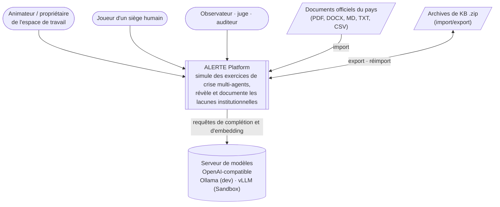
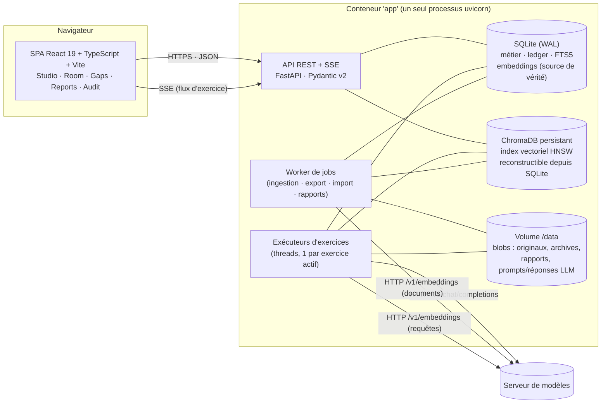
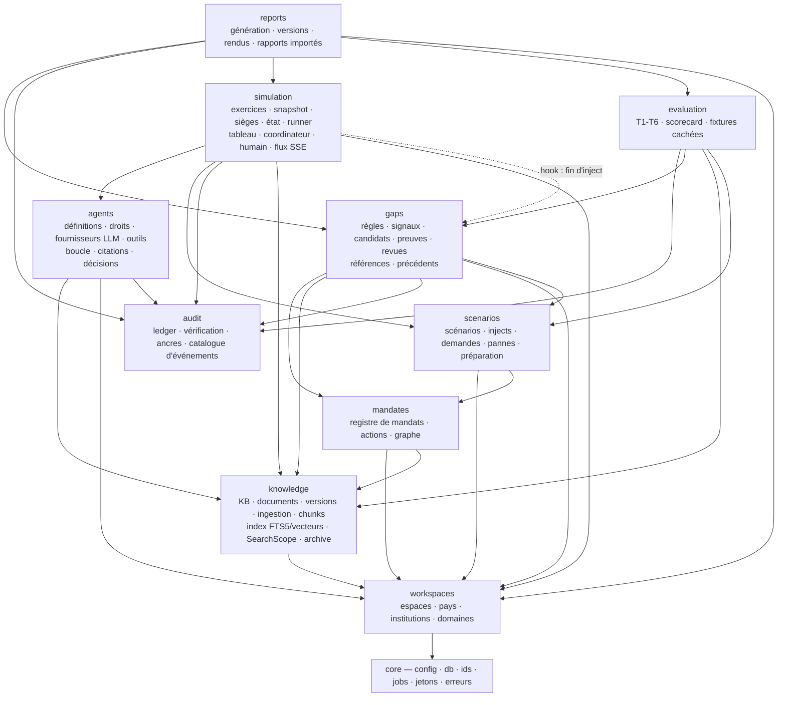

# 05 — Architecture globale (C4, modules, pile technique)

> Style : **monolithe modulaire** (BP-08) — un seul processus FastAPI, un seul processus applicatif (empaquetable en conteneur Docker ou Podman, **non obligatoire**), dix modules métier aux frontières vérifiées par test. Ports uniquement pour ce qui varie réellement (LLM, embeddings, horloge, stockage de fichiers) (BP-09).

## 5.1 C4 niveau 1 — Contexte

## 5.2 C4 niveau 2 — Conteneurs

* L'image Docker contient le SPA **déjà construit** (build multi-stage : `node:22` → `python:3.12-slim`) ; FastAPI sert `/` (SPA) et `/api/v1` (API).
* Le serveur de modèles est **hors conteneur** (Ollama en dev, vLLM sur le Sandbox) ; l'URL est une variable d'environnement.
* Aucun Redis, aucun broker, aucun service de base de données (BP-05).

## 5.3 C4 niveau 3 — Composants (backend)

Les flèches pointent vers la **dépendance autorisée** (`A --> B` : A peut importer B). Tout import absent du graphe est interdit (test d'architecture, §5.5). `simulation` appelle `gaps` uniquement via un point d'extension (`on_inject_closed`), pour que `gaps` reste testable sans moteur.

## 5.4 Modules : responsabilités, interfaces, dépendances

| Module | Responsabilité | Interface publique (service) | Dépend de |
|---|---|---|---|
| `core` | Configuration (env), session DB, identifiants, erreurs typées, jetons d'accès, file de jobs, horloge (port), `lifespan` | `get_session()`, `Settings`, `JobQueue`, `Clock` | — |
| `workspaces` | Espaces, pays, institutions, domaines ; archivage | `WorkspaceService`, `CountryService`, `InstitutionService` | core |
| `mandates` | Registre de mandats (pouvoirs, devoirs, relations), catalogue d'actions, validation humaine, graphe (NetworkX en mémoire) | `MandateRegistry.active_for(snapshot)`, `MandateGraph` | workspaces, knowledge |
| `knowledge` | KB, documents/versions, ingestion (extraction, OCR, chunking), index, **recherche à portée contrainte**, export/import d'archives, licences | `KbService`, `IngestPipeline`, `search(scope, query, k)`, `ArchiveService` | workspaces |
| `agents` | Définitions d'agent, droits agent→KB, profils de modèle, fournisseurs (scripted, cassette, openai-compat), outils, boucle d'exécution, vérification de citations, décision | `AgentRuntime.activate(ctx) -> ActivationResult`, `CitationChecker`, `LLMProvider` | knowledge, workspaces, audit |
| `scenarios` | Scénarios, injects, destinataires, **demandes**, étiquettes, pannes, contrôles de préparation | `ScenarioService`, `ReadinessChecker` | workspaces, mandates |
| `simulation` | Exercices, snapshot, sièges, machine à états, exécuteur, tableau, boîtes, coordinateur, tâches humaines, flux SSE | `ExerciseService`, `ExerciseRunner`, `stream(exercise, token, last_event_id)` | agents, scenarios, audit, knowledge, workspaces |
| `audit` | Catalogue d'événements, ajout chaîné, vérification, ancres de tête, trace de décision | `Ledger.append()`, `Ledger.verify()`, `Ledger.read(range, visibility)` | core |
| `gaps` | Règles G1–G10, signaux, candidats, preuves, recherches négatives, revues, références/précédents | `GapEngine.detect()`, `GapService`, `ReferenceMatcher` | mandates, knowledge, audit, workspaces, scenarios |
| `reports` | Assemblage du contenu, versions immuables, rendus MD/PDF/CSV/XLSX/JSON, rapports importés, comparaison | `ReportService.generate()`, `render(version, format)` | gaps, audit, simulation, evaluation, workspaces |
| `evaluation` | T1–T6, scorecard, **fixtures cachées** | `EvaluationService`, `Scorecard` | audit, gaps, knowledge, scenarios |

## 5.5 Règles de dépendance et leur vérification

1. **Graphe §5.3 seul autorisé** : un test (`tests/architecture/test_imports.py`) parse les imports de chaque package et échoue sur tout lien absent (équivalent d'`import-linter`, sans dépendance).
2. **Un module n'écrit que ses tables.** Les autres passent par son service. Revue de PR + test qui liste les tables touchées par module.
3. **`evaluation.fixtures` est privé** : aucun autre module ne peut l'importer (même test) — garantit I2 (pas de lacunes attendues dans le chemin de détection). Le conteneur de production peut exclure le répertoire des fixtures (voir doc 09 §9.9).
4. **Les routeurs** (`router.py`) n'ont pas de logique : ils valident, appellent un service, sérialisent (BP-02).
5. **Ports** (`LLMProvider`, `Embedder`, `Clock`, `BlobStore`) sont les seules abstractions ; les tests injectent des fakes.

## 5.6 Modèle d'exécution

| Élément | Choix | Justification |
|---|---|---|
| Processus | **un** uvicorn (pas de `--workers N`) | Worker et exécuteurs vivent dans le processus ; BP-05 |
| Endpoints | `def` synchrones (pool de threads Starlette) ; endpoints SSE `async` avec lecture courte via `run_in_threadpool` | SQLAlchemy synchrone, simple, suffisant (BP-10) |
| Exécuteur d'exercice | `threading.Thread` par exercice actif (plafond `ALERTE_MAX_CONCURRENT_EXERCISES`, défaut 2) ; chaque étape = une transaction ; commandes de l'animateur lues en base **entre** les étapes | Pause/reprise sans état en mémoire ; reprise après crash |
| Appels LLM | `httpx.Client` synchrone avec délai ; jamais dans la boucle d'événements | Pas de blocage des flux SSE |
| Flux SSE | Lit `ledger_event` par `seq > Last-Event-ID` toutes les ~300 ms | Une seule source de vérité (ledger) ; reprise native ; pas de bus mémoire |
| Écriture du ledger | `BEGIN IMMEDIATE`, `seq = max+1`, hash chaîné, commit avec l'action métier | Atomicité, un écrivain à la fois |
| Jobs | Table `job` + un thread worker (ingestion, export, import, rapports) ; statuts `queued/running/done/failed/interrupted` | BP-05 |
| Reprise | Au démarrage : exercices `running` → `interrupted`, jobs `running` → `interrupted` ; reprise manuelle à la dernière étape validée | BP-03, FR-36 |
| SQLite | WAL, `busy_timeout=5000`, `foreign_keys=ON`, `synchronous=NORMAL` | BP-12 |

## 5.7 Pile technique : choix et justification

| Technologie | Décision | Pourquoi / compromis |
|---|---|---|
| FastAPI + Pydantic v2 | ✔ (imposé) | OpenAPI → types TS ; schémas partagés avec les outils d'agent |
| SQLAlchemy 2.0 (synchrone) | ✔ | Simplicité ; BP-10 ; l'async n'apporte rien ici (les appels lents sont les LLM, déjà hors événements) |
| Alembic | ✔ **à partir du gel du modèle** (mardi) ; avant : `create_all` sur base jetable | Avant le gel, chaque changement de modèle ferait perdre du temps ; une migration de base est générée au gel (`render_as_batch=True`) |
| SQLite (WAL) | ✔ | Zéro service ; export de base = copie de fichier. **PostgreSQL** seulement si plusieurs instances (non prévu) |
| **ChromaDB** (index vectoriel) | ✔ **retenu comme moteur vectoriel** : index HNSW persistant, Apache-2.0, intégré au processus, installable par `pip` sur les 3 OS, **même technologie que le dépôt d'exemple ITU** ; ✗ comme source de vérité | Comparaison [A11](appendix/A11-vector-db-comparison.md) (§7.3) : **SQLite reste la source de vérité** (chunks, embeddings, droits) ; Chroma est reconstructible ; limite vérifiée : non process-safe pour écrivains concurrents → **un seul processus écrivain** (architecture V1) ; alternative serveur **Qdrant** (Apache-2.0) derrière le même port |
| BM25 (SQLite FTS5) | ✔ P0 | Composant lexical de la recherche hybride (articles et mots exacts) ; tokenisation arabe **à tester** (`unicode61 remove_diacritics 2`) ; analyseur applicatif FR/AR |
| Embeddings **BGE-M3** (dense, 1024 d) | ✔ **P0, réels**, via le port `Embedder` (client `/v1/embeddings` : Ollama, TEI, vLLM ; serveur local, machine d'équipe ou Sandbox) | Multilingue FR/EN/AR, 8192 tokens ; **empreinte complète** (modèle, révision, runtime, quantification, normalisation) enregistrée ; une requête n'est exécutée que contre des vecteurs de même empreinte ; le code est identique quelle que soit la machine |
| Fusion RRF (k=60) | ✔ **P0** | Fusion des **rangs** lexical + vectoriel ; NumPy exact = adaptateur de test et de repli de rappel (§7.3) |
| NetworkX | ✔ en mémoire seulement | Calculs de graphe de mandats pour les règles ; **non persisté** (source de vérité = tables `mandate`) |
| asyncio | ✔ pour SSE et E/S légères uniquement | Évite de réécrire en async tout le métier |
| SSE | ✔ | Unidirectionnel suffisant ; reprise native `Last-Event-ID` (BP-04) |
| Docker / Compose | ✔ | Un service `app` ; profils optionnels `ollama` (dev) et `vllm` (GPU) |
| Ollama / vLLM / TEI | ✔ serveurs de modèles et d'embeddings **configurables** (local, machine d'équipe, Sandbox) | Le même code appelle n'importe quel serveur OpenAI-compatible ; les tests IA réels s'exécutent sur une machine adaptée ([13](13-security-testing-deployment.md) §13.3) |
| vLLM / API OpenAI-compatible | ✔ Sandbox si GPU | Sorties structurées natives ; même client HTTP |
| Frontend | React 19 · TS · Vite 8 · React Router · TanStack Query · Tailwind · Radix/shadcn · react-i18next · openapi-typescript | Imposé + BP-15..19 ; graphe drag-and-drop **écarté** (matrice d'accès, plus accessible et plus rapide à livrer) |
| Cryptographie | `hashlib` (SHA-256), RFC 8785 (`canonicaljson` ou implémentation interne simple) ; `cryptography` (Ed25519) en P1 | — |
| PDF des rapports | WeasyPrint dans l'image Docker (P1) ; **repli P0** : page HTML d'impression (« Enregistrer en PDF ») | Dépendances système (pango) coûteuses à fiabiliser ; décision V3 (doc 15) |
| XLSX | `openpyxl` (déjà présent dans l'environnement) | P2 |
| Extraction PDF | `pdfplumber` (MIT) + Tesseract (`ara+fra+eng`, tessdata existant dans `alerte/ocr/tessdata`) ; **PyMuPDF évité** tant que l'AGPL n'est pas tranchée | A5 §2.4 |

## 5.8 Environnements (le dimensionnement de la machine personnelle n'est pas un critère)

| Environnement | Rôle | Remarques |
|---|---|---|
| **Poste de développement** (tout OS) | Écrire/tester le code ; backend dans un **venv Python dédié** (`backend/.venv`), frontend avec Node/nvm | Les tests unitaires utilisent des fixtures ; les appels IA réels pointent vers un serveur de l'équipe |
| **Machine(s) puissante(s) de l'équipe** | **Tests IA réels** : modèle de génération, embeddings BGE-M3, OCR lourd, charge ; héberge un serveur OpenAI-compatible accessible au reste de l'équipe | Configuration par `ALERTE_LLM_BASE_URL` / `ALERTE_EMBED_BASE_URL` |
| **Déploiement partagé / recette** | Démos d'équipe, recette de bout en bout | Docker/Podman optionnels |
| **Sandbox ITU** | **Déploiement après validation locale** ; aucune fonctionnalité n'en dépend | Capacités inconnues : voir [13](13-security-testing-deployment.md) §13.4 |
| **Démonstration finale** | Rejeu (cassette) **étiqueté** + exécution réelle si un serveur de modèles est disponible | — |

Faits relevés (sans valeur de contrainte) : Docker 29 est présent ; les modèles de génération et d'embeddings ne sont **pas** installés localement — ils vivent sur un serveur configurable.

## 5.9 Index des décisions d'architecture (ADR)

Chaque décision ci-dessous sera consignée en ADR minimal (`docs/adr/NNN-titre.md`, BP-07) **après validation** ; la liste des décisions soumises à l'utilisateur est dans le doc 15.

| ADR | Décision |
|---|---|
| 001 | Monolithe modulaire, un processus, SQLite WAL |
| 002 | Boucle d'agent maison + enveloppe d'action JSON contrainte (pas de framework d'agents) |
| 003 | Ledger = journal d'audit **et** source du flux SSE |
| 004 | Documents/versions en ajout seul ; KB version = ensemble de versions ; snapshot d'exercice par références |
| 005 | Permissions de lecture appliquées dans `SearchScope` (SQL), jamais dans le prompt |
| 006 | Détection de lacunes : registre de mandats + demandes + signaux ; fixtures cachées ; trois axes de statut |
| 007 | Fournisseurs LLM : `openai_compat`, `scripted`, `cassette` ; étiquetage « SANS IA » |
| 008 | Authentification par jetons d'espace de travail et liens capability ; pas de comptes |
| 009 | Rapports : versions immuables, MD canonique, rendus dérivés |
| 010 | Migrations Alembic au gel du modèle |
