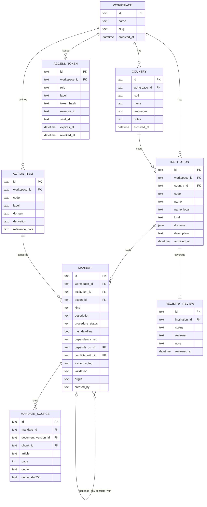
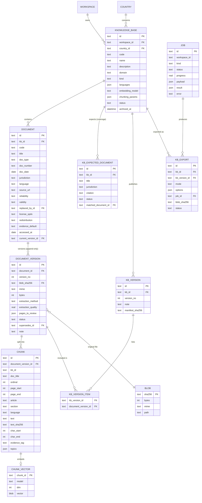
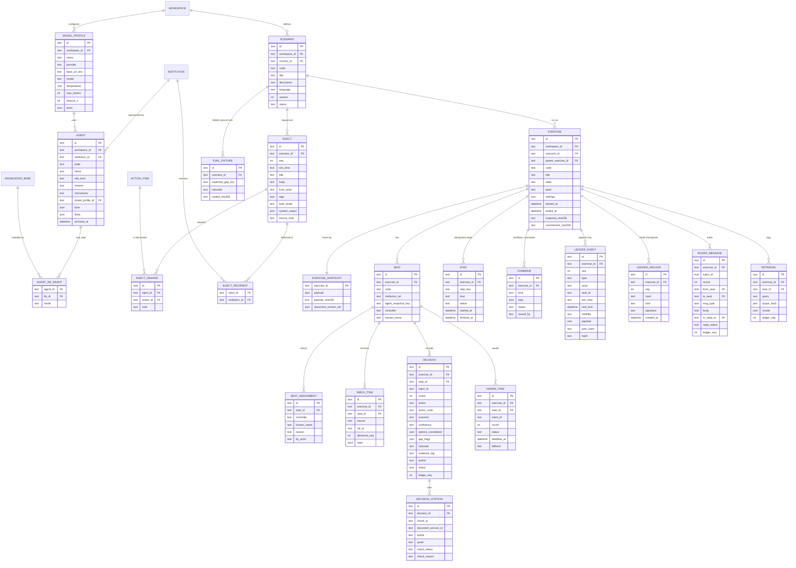
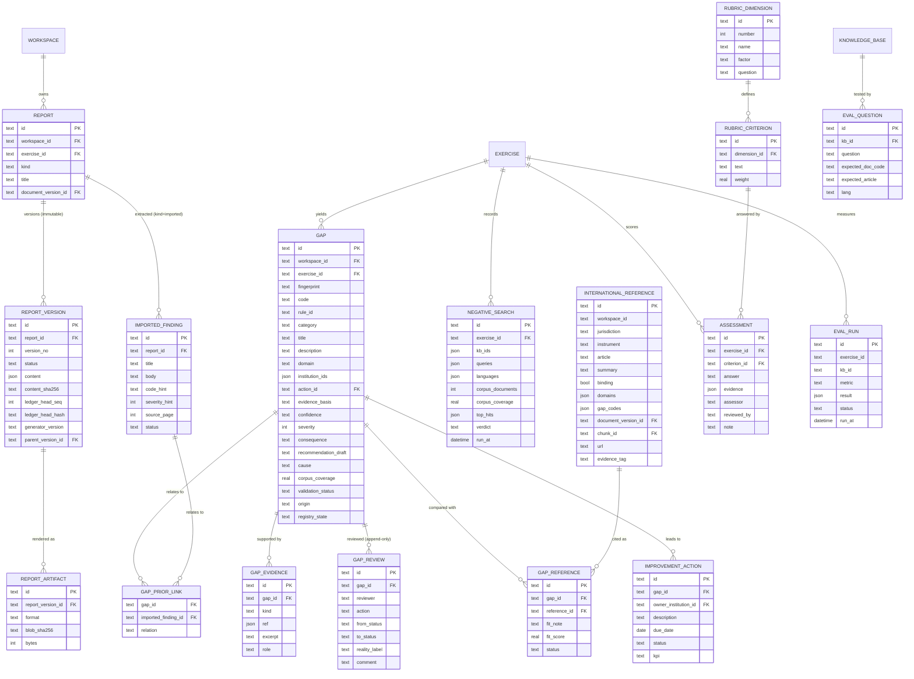

# 06 — Modèle de données (ERD)

> SQLAlchemy 2.0, SQLite. Clés primaires : **UUID v7 ou ULID** en texte (triables, non devinables), plus un `code` lisible par humain là où l'interface l'affiche. Toutes les tables portent `created_at` (UTC) ; les tables mutables portent `updated_at`. `workspace_id` est présent (dénormalisé) sur toute table de premier niveau pour le filtrage d'isolation ; **aucune requête de service ne peut omettre le filtre d'espace** (dépendance FastAPI `current_workspace` + test canari FR-01). Les dates sont ISO 8601 UTC ; les JSON sont validés par des modèles Pydantic à l'écriture.

## 6.1 Espaces de travail, pays, institutions, mandats

| Table | Remarques |
|---|---|
| `access_token` | Rôles : `owner`, `facilitator`, `player` (lié à un `seat_id`), `observer`, `auditor`. Seul le **hash** du jeton est stocké. Jetons de siège/observateur liés à un exercice ; expiration et révocation. |
| `institution.kind` | `ministry \| agency \| regulator \| operator \| local_authority \| ai_system \| advisory \| other` ; `ai_system` désigne le système IA testé (comportement scénarisé). |
| `action_item` | Catalogue d'actions (« ce que la situation exige », ex. « valider une prévision IA avant diffusion »). `derivation` ∈ `referential \| scenario_author \| agent_proposed` ; `reference_note` cite le référentiel externe (Sendai, checklist ITU, etc.). Règle d'intégrité : une action dont `derivation = scenario_author` est signalée dans le rapport. |
| `mandate.kind` | `power \| duty \| lead \| coordination \| information_sharing \| procedure \| human_oversight \| liability \| inclusion \| channel_protection \| international_agreement \| prohibition`. Les règles G1–G10 testent la **présence ou l'absence** d'un mandat d'un `kind` donné pour une action ou un domaine (doc 09). |
| `mandate.validation` | `proposed \| validated \| rejected` ; seules les lignes `validated` comptent comme preuve **documentée** ; `proposed` donne une preuve de confiance moindre. |
| `mandate_source` | Un mandat actif **doit** pointer vers un chunk réel (test CI). Un mandat est *actif dans un exercice* si la version de document de sa source figure dans le snapshot (c'est ce qui rend le test contrefactuel possible). |
| `registry_review` | Par institution : `unreviewed \| partial \| reviewed_complete`. Sans `reviewed_complete`, une absence de mandat produit une lacune d'`evidence_basis=inferred`, pas `documented` (doc 09 §9.3). |

## 6.2 Bases de connaissances

| Point | Détail |
|---|---|
| **Ajout seul** | Un document modifié = nouvelle `document_version` (l'ancienne reste, `supersedes_id`). Supprimer un document marque la version `retired` ; les chunks sont conservés tant qu'une `kb_version` publiée ou un exercice les référence. |
| `knowledge_base.kind` | `national \| global_practices \| scenario \| prior_reports \| mixed`. `global_practices` alimente les précédents ; `prior_reports` héberge les rapports de lacunes importés (doc 09). |
| `document.reliability` | `official \| summary \| unofficial \| not_found` ; `validity` : `in_force \| replaced \| unknown` (+ `replaced_by_id`) — D-07. |
| `document.redistribution` | `allowed \| restricted \| unknown` + `license_spdx` (ou `LicenseRef-…`). Défaut `unknown` ; l'export « ouvert » exclut `restricted` et `unknown`. |
| `chunk.kb_id` | Dénormalisé : sert au pré-filtrage de sécurité dans les requêtes FTS/vecteurs. |
| Index FTS5 | Table virtuelle `chunk_fts(text, doc_title, article, content='chunk')` (`doc_title` dénormalisé dans `chunk`) + colonnes non indexées (`kb_id`, `document_version_id`). Création par SQL brut (non gérée par l'ORM) ; reconstruction = job `reindex`. |
| `kb_version` | Publier = figer l'ensemble des `document_version_id` ; `manifest_sha256` = empreinte canonique de l'ensemble (identité de la version). |
| `blob` | Stockage adressé par contenu (`/data/blobs/ab/abcdef….bin`) : originaux, archives, rapports, prompts et réponses LLM. |

## 6.3 Agents, scénarios, exercices, ledger

| Point | Détail |
|---|---|
| `agent.role_kind` | `institution \| ai_system \| legal_adviser` (le coordinateur n'est **pas** un agent : c'est du code, FR-32). `ai_system` est joué par `system_output` des injects (comportement scénarisé du système IA testé). |
| `agent.tools` | Sous-ensemble de `search_kb, ask_legal, post, decide` ; `limits` : `max_steps` (défaut 4), `max_legal_calls_per_inject` (défaut 2), `max_search_calls` (défaut 3). |
| `agent_kb_grant` | **Seule** source de droits de lecture. Copiée dans le snapshot au lancement. `mode=read` (seul mode au MVP). Le conseiller juridique reçoit par défaut toutes les KB de l'exercice (configurable). |
| `inject.fault_mode` | Panne injectée : `none \| over_trust \| silent_institution \| misinformation \| llm_outage \| …` (12 « failure modes » de la Spec L275-290 comme catalogue extensible). |
| `inject.tags` | Étiquettes normalisées lues par les règles : `life_risk, rights_risk, harm_possible, ai_output_used_in_decision, public_communication, channel_abuse, foreign_actor, time_critical, …`. |
| `eval_fixture` | `expected_gap_key` est calculée **comme `gap.fingerprint`** (code · action · institutions · domaine) pour permettre l'appariement. **Table isolée** (sous-module `evaluation`), jamais lue par `gaps`, `agents` ni `simulation`. `sealed_sha256` = empreinte horodatée de la fixture, consignée avant les runs (doc 09 §9.9). |
| `exercise_snapshot.payload` | JSON canonique de : pays, institutions, agents (copie), profils de modèle (sans secrets), droits agent→KB, scénario et injects, actions, mandats **validés** actifs, paramètres, `document_version_ids`. Son SHA-256 est inscrit dans le premier événement du ledger. |
| `seat.controller` | `agent \| human \| scripted` ; historique complet dans `seat_assignment` (événement `SEAT` au ledger). |
| `step` | Clé unique `inject:{n}:round:{r}:seat:{code}` etc. : une étape terminée est sautée à la reprise (idempotence, BP-14). |
| `command` | Commandes de l'animateur (`start, pause, resume, step, speed, stop, surprise, seat_switch, correction`) consommées par l'exécuteur entre deux étapes. |
| `ledger_event` | `UNIQUE(exercise_id, seq)`. `visibility` : `public \| board \| seat \| audit` (+ `seat_id` pour `seat`). Les prompts et réponses LLM complets sont dans `blob` ; le ledger porte `prompt_sha256`, `response_sha256` (voir doc 10). |
| `board_message.reply_status` | `accepted \| refused \| not_our_role \| null` quand le message répond à un REQUEST (D-31). |
| `decision.status` | `recorded \| not_verified \| not_recorded` : `not_verified` = citations échouées après relance (visible, rouge) ; `not_recorded` = JSON invalide deux fois (une entrée ERROR l'accompagne). Jamais de disparition silencieuse. |
| `decision.outcome` | `act \| decline \| refer \| no_legal_basis_found` (nul si `status=not_recorded`). `author` ∈ `agent \| human \| fallback`. `legal_basis` n'est pas une colonne : il est **reconstruit** depuis `decision_citation`. |
| `decision_citation.check_status` | `pass \| fail` + `check_reason` (chunk absent, hors droits, hors retrieval de l'activation, article incohérent, citation introuvable dans le texte). |

## 6.4 Lacunes, références, rapports, évaluation

| Point | Détail |
|---|---|
| `gap.fingerprint` | `sha256(code \| action_code \| institutions triées \| domaine)` : identifie « la même lacune » entre exercices (comparaison, persistance, résolution). |
| `gap.code` / `category` | `code` ∈ `G1…G10` ou `X…` (extensions) ; `category` ∈ typologie de 17 catégories (doc 09 §9.2). |
| Trois axes (FR-52) | `evidence_basis` : `documented \| observed \| inferred \| hypothesis` · `confidence` : `high \| medium \| low` · `validation_status` : `proposed \| confirmed \| disputed \| rejected` (le **statut** ne peut passer à `confirmed` que par une `gap_review` humaine). |
| `gap.registry_state` | État du registre au moment de la détection (`reviewed_complete` / `partial` / `unreviewed`) — affiché dans le rapport. |
| `gap_evidence.kind` | `mandate \| chunk \| event \| message \| decision \| negative_search \| imported_finding \| coordinator_signal` ; `role` : `supports \| counter \| context` (les contre-preuves sont conservées, pas masquées). |
| `negative_search` | Enregistre les requêtes standardisées lancées pour tester une absence : `verdict` ∈ `no_hit \| weak_hit \| strong_hit` ; nombre de documents du corpus, langues, meilleurs scores. |
| `gap_review` | **Append-only** ; `reality_label` ∈ `real \| partially_real \| not_real` alimente T4. |
| `international_reference` | Bibliothèque de précédents (par espace, ou globale). **Chaque entrée doit référencer un `chunk`** d'une KB `global_practices` *ou* une URL + `evidence_tag=summary` explicite. Pas d'entrée sans source. |
| `report.kind` | `generated \| imported`. Un rapport importé n'est jamais mêlé aux lacunes générées ; `gap_prior_link` en garde la relation (`previously_identified \| newly_emerged \| contradicts`). |
| `report_version` | Immuable une fois `published` ; `content` JSON structuré = source unique ; `ledger_head_*` lie le rapport à l'état du ledger au moment de la génération. |
| `rubric_*`, `assessment` | `answer` ∈ `yes \| partial \| no \| not_assessed` ; **score = dérivé** des réponses ; `not_assessed` n'est jamais 0. |
| `eval_run.status` | `computed \| not_computed` (I6). |

Notes : `gap_rule` n'est **pas** une table : les règles sont une table de règles **en code** (`gaps/rules/`), versionnée avec le moteur ; `import_map` (correspondance d'identifiants à l'import d'une archive : `{archive_id, local_id, kind}`) est une table du module `knowledge`.

## 6.5 Contraintes d'intégrité transverses

* `ledger_event`, `gap_review`, `seat_assignment`, `report_version` (publiée), et le **contenu** de `document_version`/`chunk` (fichier, texte, hash) : **pas de `UPDATE`/`DELETE` applicatif**. Seules des colonnes de **cycle de vie** sont mutables (`document_version.status`, `archived_at`), chaque changement étant écrit comme événement de cycle de vie (journalisé) ; test qui parcourt les services et échoue si une mise à jour est tentée. (SQLite n'ayant pas de droits par table, des **triggers** `BEFORE UPDATE/DELETE … RAISE(ABORT)` sont posés sur `ledger_event` et `gap_review`.)
* Suppression : un pays/institution/KB/agent/scénario *référencé par un exercice lancé* ne peut être que **archivé** (`archived_at`) ; seuls les brouillons non référencés sont supprimables (U§8).
* Clés étrangères activées (`PRAGMA foreign_keys=ON`) ; index sur `(exercise_id, seq)`, `(workspace_id, …)`, `chunk(kb_id)`, `chunk(document_version_id)`, `gap(fingerprint)`.
* Aucun chemin absolu en base : les fichiers sont désignés par `blob.sha256` ; le répertoire de données est configuré par `ALERTE_DATA_DIR`.

## 6.6 Compléments (corrections ciblées du 2026-11-21)

| Élément | Précision |
|---|---|
| `kb_expected_document` | Liste *attendue* par KB (titre, juridiction, citation, statut `present \| missing \| replaced`) ; alimente `negative_search.corpus_coverage` et `gap.corpus_coverage` |
| `gap.cause` | `institutional \| documentary \| artifact \| undetermined` ([09](09-gap-analysis-and-reports.md) §9.9) |
| `exercise.commitment_sha256` | Pré-engagement : empreinte des règles, demandes, registre et catalogue d'actions au lancement |
| `action_item.derivation` | `referential \| scenario_author \| agent_proposed` + **justification obligatoire** ; seule une action `referential` est présentée comme « attente documentée » |
| Embeddings | Stockés dans SQLite (source de vérité) avec l'**empreinte complète de l'embedder** ; l'index Chroma en est dérivé et reconstructible |
