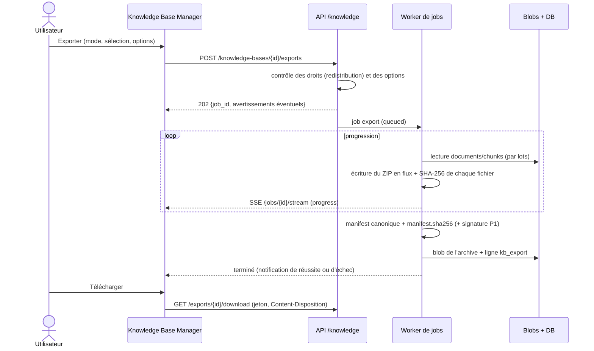
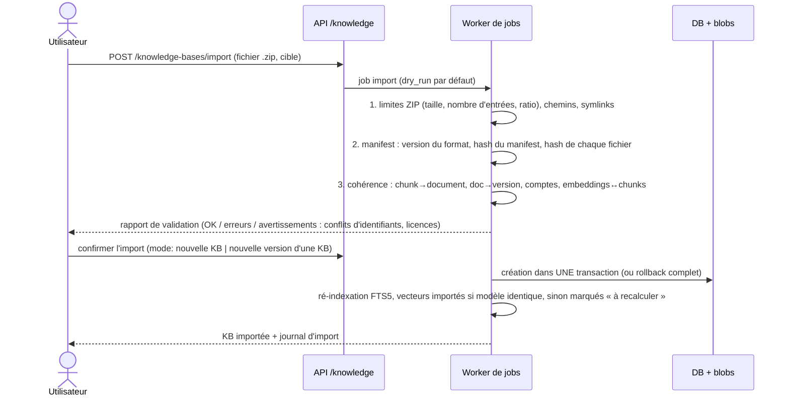

# 07 — Bases de connaissances, pipeline documentaire, RAG et export

> Pratiques appliquées : BP-20…27 (doc 04). Décisions : ADR 004 (versions), 005 (permissions dans le SQL). Recherche détaillée : annexe [A5](appendix/A5-research-rag-kb-export.md).

## 7.1 Pipeline documentaire

```mermaid
flowchart LR
  U["Upload<br/>PDF · DOCX · MD · TXT · CSV"] --> V{"Contrôles<br/>type · taille · hash<br/>lisible ?"}
  V -- refus --> X["Rejet + raison"]
  V --> B[("Blob adressé<br/>par SHA-256")]
  B --> J[["Job ingest"]]
  J --> E["Extraction<br/>texte par page<br/>(+ OCR des pages scannées)"]
  E --> N["Normalisation<br/>NFC · caractères invisibles<br/>en-têtes/pieds répétés"]
  N --> S["Détection de structure<br/>articles · sections · tableaux"]
  S --> C["Chunking<br/>conscient des articles"]
  C --> Q["Contrôle qualité<br/>couverture · OCR · pages à relire"]
  Q --> I["Index FTS5<br/>+ embeddings BGE-M3 + index vectoriel (Chroma)"]
  I --> R["document_version = ready<br/>/ needs_review"]
  R --> H["Revue humaine<br/>métadonnées · licence · validité"]
  H --> P["Publication :<br/>nouvelle kb_version"]
```



| Étape | Choix | Détail |
|---|---|---|
| Contrôles d'entrée (BP-27) | Liste blanche d'extensions + vérification du type réel (signature) ; taille max par fichier (défaut 100 Mo, configurable) ; nom de fichier **jamais** utilisé comme chemin (nom généré = hash) ; détection de doublon par SHA-256 | Refus explicite avec message ; PDF chiffré = refus |
| Extraction PDF | `pdfplumber` (couche texte, par page) ; page sans texte ou très pauvre (< 80 caractères) → rendu image + **Tesseract** (`ara+fra+eng`, tessdata existant) | Qualité = moyenne du ratio « caractères reconnus/page » et confiance OCR ; stockée dans `extraction_quality` |
| DOCX / MD / TXT / CSV | `python-docx` (P1) ; Markdown/texte : lecture directe ; CSV : une ligne = un chunk avec en-têtes | CSV utile pour les registres de mandats (voir doc 09) |
| Normalisation | Unicode NFC ; suppression des caractères de contrôle et **invisibles** (zero-width, balises Unicode « tag ») ; direction RTL préservée pour l'arabe ; suppression des en-têtes/pieds de page répétés (heuristique) | Défense BP-29 ; chaque modification est comptée dans le rapport de qualité |
| Détection de structure | Expressions régulières multilingues : `Article N`, `Art. N`, `المادة N`, `Section`, `Chapitre/Chapter/الفصل` | Reprise de la logique éprouvée de l'ancien `chunk.py` (réutilisable après relecture) |
| Chunking | Un chunk = un article ; si > `max_chars` (2 000) coupé par paragraphes avec chevauchement de 200 caractères, l'`article` est conservé ; sans structure : fenêtres de ~512 tokens avec 25 % de recouvrement ; préfixe `titre · article · page` stocké à part (non vectorisé par défaut) | Paramètres sauvegardés dans `knowledge_base.chunking_params` et dans l'archive |
| Contrôle qualité | Par document : pages, caractères/page, % de pages OCR, nb d'articles détectés, langue détectée, pages à relire ; **alerte** si un document attendu a < 500 caractères utiles | Alimente le rapport de qualité de la KB (critère C1) ; corrige les cas connus : scan quasi vide, mauvais fichier |
| Index | FTS5 (`unicode61 remove_diacritics 2`) sur `text`, `title`, `article` **et** index vectoriel (ChromaDB persistant) alimenté par des embeddings **réels** (BGE-M3 par défaut) ; les embeddings sont aussi stockés dans SQLite (source de vérité) | Tokenisation arabe **à tester** ; l'empreinte complète de l'embedder est enregistrée |
| Revue | L'utilisateur voit chaque document : aperçu page par page, métadonnées (titre, numéro, date, juridiction, fiabilité, **validité**, licence, redistribuable), chunks, avertissements ; peut corriger et relancer l'indexation | Rien n'est publié sans clic « Publier la version » |

### Métadonnées proposées automatiquement

Titre (première page), langue (détection), numéro/date de texte (regex), type (loi/décret/arrêté/stratégie/standard/rapport — heuristique). **Aucune métadonnée de licence n'est devinée** : `redistribution = unknown` tant qu'un humain ne l'a pas renseignée. L'extraction de métadonnées par LLM est en P2.

## 7.2 Chunk et provenance

Chaque chunk porte : `id`, `document_version_id`, `kb_id`, `page_start/end`, `article`, `section`, `language`, `text`, `text_sha256`, `char_start/end`, `evidence_tag` (`documented | inferred | assumed`, hérité de `document.evidence_default`), `topics`. Les citations (`decision_citation`, `mandate_source`) référencent `chunk.id` **et** l'`article`/`page` de ce chunk ; le contrôle de citation vérifie la cohérence (doc 08 §8.5).

## 7.3 Recherche hybride réelle : lexical + vectoriel + fusion, avec permissions strictes

### Choix du moteur vectoriel (comparaison ciblée — détail et sources : [A11](appendix/A11-vector-db-comparison.md))

| Solution | Licence | Persistance / portabilité | Filtrage | Concurrence | Distribué | Verdict pour ALERTE |
|---|---|---|---|---|---|---|
| **ChromaDB** | Apache-2.0 [V] | Local persistant par `pip` sur les 3 OS ; export logique à faire (nous le faisons depuis SQLite) | `where` (`$eq`, `$in`…) ; pré/post-filtrage **non documenté → à tester** | **Non process-safe** pour écrivains concurrents sur un même chemin ; thread-safe [V] | Cloud/serveur ; pas de cluster self-hosted vérifié | **Retenu** : intégré au processus unique de l'architecture V1, **même moteur que le dépôt d'exemple ITU**, HNSW réel ; hybride BM25/sparse natif réservé à Chroma Cloud → lexical assuré par SQLite FTS5 |
| Qdrant | Apache-2.0 [V] | Serveur (Docker/binaire) ; mode local Python | Index de payload ; pré-filtrage **non vérifié** | Serveur multi-clients | Cluster supporté [NV] | **Adaptateur optionnel** (déploiement partagé) derrière le même port ; non retenu par défaut (serveur obligatoire, installation 3 OS plus lourde) |
| Milvus / Milvus Lite | Apache-2.0 [V] (paquet Lite [NV]) | Lite : un fichier, 1 processus ; migration 2.x→3.x par export | Oui | Lite : 1 processus | Standalone/Distributed | Non retenu (Lite non prévu pour la production ; format non rétro-compatible) ; analyseur arabe documenté (intérêt lexical seulement) |
| PostgreSQL + pgvector | PostgreSQL License [V] | Exige un serveur PostgreSQL (pas de binaire pgvector Windows officiel connu [NV]) | Filtre appliqué **après** le parcours HNSW par défaut [V] | MVCC | Réplication | Non retenu : impose PostgreSQL (hors architecture V1) |
| FAISS | MIT [V] | Bibliothèque (fichiers d'index à gérer) | **Aucun** filtrage natif | Aucune | Non | Non retenu (permissions à tout réimplémenter) |
| LanceDB | Apache-2.0 [V] | Embarqué, format Lance | [NV] | [NV] | Cloud | Non retenu (non vérifié dans le temps imparti) |
| sqlite-vec | Apache-2.0 / MIT [V] | Extension SQLite | Colonnes de métadonnées [V] | SQLite | Non | Non retenu (pré-v1, ruptures d'API annoncées) |

**Décision** : **ChromaDB comme index vectoriel**, **SQLite FTS5 pour le lexical**, **fusion RRF dans l'application**, derrière les ports `VectorIndex` / `LexicalIndex` ; **SQLite reste la source de vérité** (chunks, embeddings en BLOB, droits, versions). Chroma est reconstructible depuis SQLite (job `reindex`). Un adaptateur **NumPy exact** (sur les embeddings stockés dans SQLite) sert aux tests de contrat et de **garde de rappel** ci-dessous ; **Qdrant** est l'adaptateur de remplacement pour un déploiement partagé. Risque assumé : le comportement exact du filtre de Chroma (pré ou post) n'est pas documenté → **vérifié par test** dès la phase 2 (voir « Garde de rappel »).

### Embeddings : fournisseur indépendant

Port `Embedder` : client `/v1/embeddings` (Ollama, TEI, vLLM) ; **BGE-M3** par défaut (MIT, 1024 dimensions, FR/EN/AR) ; **empreinte complète** (modèle, révision, runtime, quantification, normalisation, dimension) enregistrée avec la KB ; une requête n'est exécutée que contre des vecteurs de même empreinte, sinon **refus explicite** ou ré-embedding de la KB. L'embedding est un **job reprenable par chunk** (les chunks déjà embarqués sont sautés). Le serveur d'embeddings peut tourner sur n'importe quelle machine : seule la configuration change.

### `SearchScope` (sécurité par construction)

```python
@dataclass(frozen=True)
class SearchScope:
    workspace_id: str
    kb_ids: frozenset[str]                 # dérivé des droits agent→KB du SNAPSHOT de l'exercice
    document_version_ids: frozenset[str]   # versions figées de l'exercice (ou version publiée courante hors exercice)
    purpose: Literal["agent", "human_seat", "analyst", "ui_preview", "eval"]
    seat_id: str | None                    # tracé dans RETRIEVAL

def search(scope: SearchScope, query: str, k: int = 5, *, filters: SearchFilters | None = None) -> list[Hit]: ...
```

### Vérification stricte des permissions (corrections ciblées)

1. **Le `SearchScope` n'est construit que par le backend**, jamais depuis un paramètre d'outil, d'URL ou de corps de requête ; `filters` ne peuvent que **restreindre**.
2. **Deny-by-default** : portée vide → aucun résultat.
3. **Pré-filtrage dans chaque moteur** : SQL (`WHERE chunk.kb_id IN (…) AND chunk.document_version_id IN (…)`) pour le lexical ; `where` Chroma sur `kb_id` (et `document_version_id`) pour le vectoriel.
4. **Revérification SQL de chaque résultat** : *tout* `chunk_id` renvoyé par un moteur (lexical **ou** vectoriel) est **revérifié contre la portée en SQL** avant d'atteindre l'agent ; un chunk hors portée est **écarté**, un événement de sécurité `SCOPE_VIOLATION` est consigné (jamais silencieux) et le test associé échoue en CI.
5. **Garde de rappel** : si, après revérification, moins de `k` résultats subsistent alors que la portée contient ≥ `k` chunks, la requête est **rejouée en exact** (NumPy sur les embeddings SQLite, restreints à la portée) : aucune perte de rappel due à un filtre post-index, **aucune fuite**.
6. `RETRIEVAL` journalise la requête, le `scope_hash`, l'empreinte d'embedder, les ids et scores.
7. **Défense en profondeur** : le contrôle de citation revérifie que le `chunk_id` cité appartient au retrieval de l'activation **et** à la portée du siège.
8. **Tests** (bloquants en CI) : (a) **propriété** — aucun chunk hors portée n'est renvoyé, sur **chaque** adaptateur, avec canaris `CANARY-<uuid>` et requêtes reformulées/injectées ; (b) **inter-espaces** ; (c) **niveau HTTP** — un jeton de siège/observateur ne peut lire ni chunk, ni boîte, ni ledger hors de ses droits par aucune route ; (d) rappel sur petite portée (1 % du corpus) ≥ seuil.

### Algorithme hybride

```
lexical = FTS5 bm25(query) sur chunks de la portée                     -> top 50
dense   = Chroma.query(embed(query), where=portée)  (+ garde de rappel)  -> top 50
fusion  = RRF(k=60) sur les RANGS des deux listes ; revérification SQL de chaque résultat
hit     = top k  (chunk_id, doc_code, titre, article, page, snippet, score, signaux{lexical,dense})
```

* **Mode dégradé** : moteur d'embeddings injoignable → lexical seul, bandeau « recherche dégradée » dans l'UI, `RETRIEVAL.signals.degraded=true`, rapport signalé. Jamais présenté comme la recherche hybride.
* Les numéros d'articles (« Article 33 ») sont aussi traités comme **filtre exact** (OU).
* Reranker (`bge-reranker-v2-m3`, Apache-2.0) : activé **après mesure** (recall@5 sous le seuil) ; Contextual Retrieval : optionnel (BP-25).
* Libellé honnête dans l'UI et les rapports : « BM25 (FTS5) + vectoriel (BGE-M3) + RRF ».

### Recherche négative (pour les lacunes)

`search_absence(scope=analyste, topic_queries[], languages[])` lance des requêtes standardisées (libellé de l'action dans chaque langue de la KB + synonymes) et enregistre `negative_search` (requêtes, langues, nombre de documents, **couverture documentaire**, meilleurs scores, `verdict`). Une absence n'est affirmée que comme « *non trouvée dans le corpus K (N documents ; couverture c %)* », jamais comme « n'existe pas » (I3).

## 7.4 Défense contre les instructions malveillantes des documents

| Couche | Mesure |
|---|---|
| Ingestion | Caractères invisibles retirés ; motifs suspects (« ignore previous instructions », « call decide », balises d'outil) **signalés** dans le rapport de qualité (le texte légal légitime n'est pas modifié) ; PDF/zip piégés : limites de taille, nombre d'objets, profondeur |
| Prompt | Les extraits sont insérés dans un bloc délimité `<retrieved_document untrusted="true" id="…">…</retrieved_document>` ; le prompt système indique que ce contenu est une **donnée** ; aucune instruction d'un document n'a d'autorité |
| Outils | Autorisations **dans le code** : un chunk ne peut ni ajouter d'outil, ni changer de `to`, ni forcer une décision ; `decide` passe par validation + contrôle de citation ; `post` ne peut viser que des sièges existants |
| « Rule of Two » | Un agent traitant du contenu non fiable n'a pas d'action externe : ses sorties sont des enregistrements internes (board/décision) et les actions « à fort impact » du simulateur n'ont aucun effet hors simulation |
| Sortie | Rendu en texte/Markdown échappé ; pas de chargement automatique d'URL ; caractères de contrôle retirés avant le ledger |
| Tests | Adversariaux n°1, 2, 8, 9 (doc 13) |

## 7.5 Versions de KB et reproductibilité

* `document_version` immuable ; `kb_version` = ensemble figé ; `exercise_snapshot.document_version_ids` = ce que l'exercice a pu lire.
* Mise à jour d'un document : nouvelle version → nouvelle `kb_version` à publier ; les exercices passés ne changent pas.
* Document « remplacé » : `validity = replaced` + `replaced_by_id` ; **jamais** utilisé comme règle courante par défaut (filtre `validity != replaced` dans `SearchScope` des agents, désactivable par l'animateur pour des exercices historiques).
* Reconstruction d'index : job `reindex(kb_id)` qui régénère FTS5/vecteurs depuis `chunk.text` sans toucher aux chunks.

## 7.6 Export et réimport

### Modes d'export (interface : Knowledge Base Manager → « Exporter »)

| Mode | Contenu | Usage |
|---|---|---|
| **Complet réimportable** (défaut) | Manifest, documents, chunks, originaux (si droits), config, embeddings (option), registre de mandats lié (option) | Migration entre installations, publication, sauvegarde |
| **Traité seulement** | Sans fichiers originaux : texte, chunks, métadonnées | Partage quand la redistribution des originaux est restreinte |
| **Documents seulement** | Originaux sélectionnés + métadonnées | Remise à un tiers |
| **Sélection** | N'importe quel mode, restreint à des documents cochés | — |
| **Ouvert (publication)** | Complet mais **exclut** les documents `restricted` ou `unknown` ; échoue avec la liste si la sélection en contient | E9 : « base de connaissances publiée » |

### Format de l'archive (inspiré de BagIt, RFC 8493 — BP-26)

```
alerte-kb-<code>-v<version>-<date>.zip
├── manifest.json                 # métadonnées, hashes, config, droits (JSON canonique RFC 8785)
├── manifest.sha256               # empreinte du manifest canonique
├── bag-info.txt                  # résumé lisible par un humain
├── data/
│   ├── kb.json                   # nom, description, pays, domaine, langues, kind, version
│   ├── documents.jsonl           # une ligne par document + version (métadonnées, licence, validité)
│   ├── chunks.jsonl              # une ligne par chunk (id, doc, page, article, texte, sha256…)
│   ├── mandates.jsonl            # (option) mandats + sources rattachés aux documents de la KB
│   ├── references.jsonl          # (option) références internationales de la KB
│   ├── sources/<doc_code>-v<n>.<ext>    # originaux (si autorisé)
│   └── embeddings/bge-m3.f32.npy + embeddings.index.jsonl   # (option) matrice + ordre des chunk_id
└── signature.json                # (P1) Ed25519 sur manifest.sha256
```

Champs obligatoires du `manifest.json` : `format="alerte-kb-archive"`, `format_version` (SemVer), `kb` (id, code, nom, version, langues, pays/domaine), `created_at`, `exporter` (nom/version), `mode`, `files[]` (`path`, `sha256`, `bytes`, `records`), `embedding` (modèle, dimension, normalisé, `included`), `chunking` (stratégie, paramètres), `documents_summary` (nombre, licences, `redistribution` comptés par valeur), `provenance` (outil d'ingestion, versions), `warnings[]`. **Aucun chemin absolu, aucun identifiant de machine, aucun secret** (liste blanche stricte : seuls `manifest*`, `bag-info.txt`, `signature.json`, `data/**` sont écrits).

### Séquence d'export



### Séquence d'import



* **Identifiants** : l'import **préserve** les identifiants si aucun conflit ; sinon table de correspondance (`import_map`) enregistrée et affichée ; les citations internes de l'archive (mandats→chunks) sont réécrites via cette table.
* **Embeddings** : réutilisés si `embedding.model` et `dimension` correspondent à la configuration cible ; sinon recalcul (job optionnel).
* **Idempotence** : réimporter la même archive (même `manifest.sha256`) dans le même espace = refus avec lien vers la KB existante, ou création d'une nouvelle version sans doublon de chunks (par `text_sha256`).
* **Intégrité** : échec de n'importe quel hash = import **refusé en entier**.
* **Indépendance** : l'archive ne dépend ni de SQLite, ni de FTS5, ni de ChromaDB ; tout index est reconstructible depuis `chunks.jsonl`.

### Droits documentaires et licences

* Chaque document porte `license_spdx` et `redistribution`. Valeur par défaut : `unknown`.
* **Avant l'export** : l'interface affiche un tableau « redistribuable / restreint / inconnu » ; les modes *Ouvert* et *Traité seulement* appliquent des règles distinctes (le texte extrait d'un document restreint n'est pas exporté en mode ouvert).
* La licence du **logiciel** (MIT, à décider) ne s'applique pas aux textes officiels (D-29) ; un `LICENSES.md` généré liste les licences du contenu.
* Cas connus de l'inventaire (A3) à qualifier avant publication : rapports de la Banque mondiale, article Springer, publications OMS, documents ITU, corpus UE.

## 7.7 Page Knowledge Base Manager

| Zone | Contenu |
|---|---|
| Liste des KB | Nom, pays, domaine, langues, version publiée, documents, état d'indexation, qualité (jauge) |
| Détail d'une KB | Onglets : **Documents** (table filtrable : statut, validité, licence, qualité), **Chunks** (recherche, aperçu avec page/article), **Qualité** (couverture, pages à relire, OCR, alertes d'injection), **Versions** (publier, comparer), **Index** (état, reconstruire), **Export/Import** |
| Document | Aperçu, métadonnées modifiables, historique de versions, pages à relire, remplacer/retirer, « remplacé par » |
| Exporter | Assistant : mode → sélection de documents → options (embeddings, mandats, références) → contrôle des droits → progression → téléchargement |
| Importer | Dépôt d'une archive → rapport de validation (dry-run) → confirmation → progression |

## 7.8 Amorçage de la démonstration (réutilisation de l'existant)

Aucune ré-extraction des PDF : le texte déjà extrait est réutilisé. Un script `scripts/legacy_to_archive.py` convertit `alerte/index/documents.json` + `chunks.jsonl` (4 235 chunks, 45 documents, indexés le 2026-11-11) en archives au format ci-dessus (une archive par collection : « Cameroun », « Émirats », « Pratiques mondiales »), puis l'application les **importe par l'interface** (ce qui teste aussi l'import). Corrections nécessaires, déjà identifiées (A3) : fichier **AE-04** = charte IA des EAU (pas la chaîne d'alerte), AE-06 = article scientifique, CM-14 article de presse, CM-17 et GL-07 rapports de la Banque mondiale (droits à vérifier), CM-01 et CM-07 scans quasi vides, 141 pages à relire, **aucune colonne de licence** (donc `redistribution = unknown` partout → export ouvert vide tant qu'un humain n'a pas qualifié les droits). Les documents absents (AE-03, AE-07, CM-06, GL-08, GL-10, ITU-03/04) sont déclarés « manquants » dans le rapport de qualité, jamais inventés.

## 7.9 Évaluation de la qualité de la KB (critère officiel C1)

Rapport généré par KB : complétude (documents attendus vs présents — liste attendue saisie par l'utilisateur), exactitude (extraction : caractères/page, OCR, pages à relire), structure (% de documents avec articles, articles/page), duplications, langues, métadonnées manquantes, droits. T1 (retrieval) s'exécute sur un jeu de questions de la KB (`eval_question`), importable en CSV.
