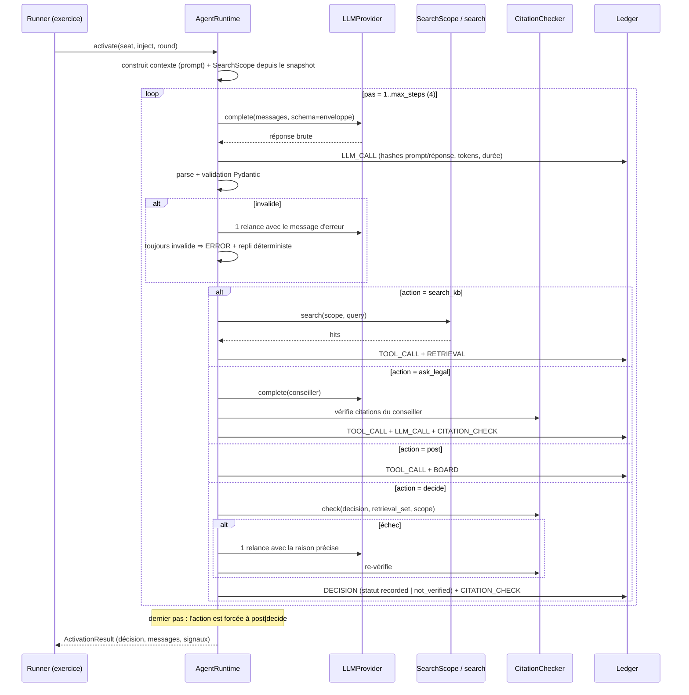
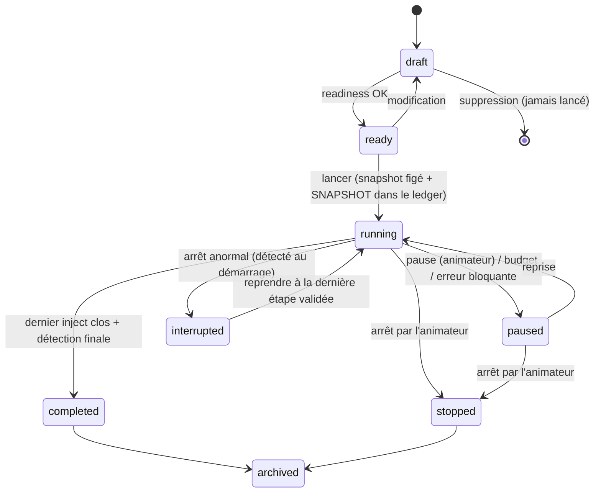
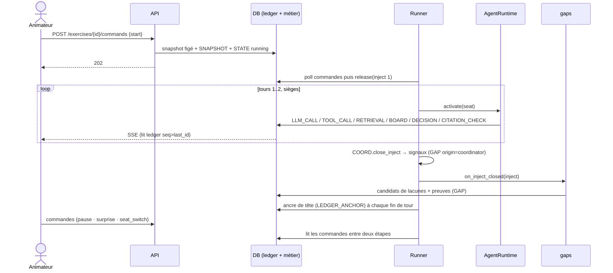
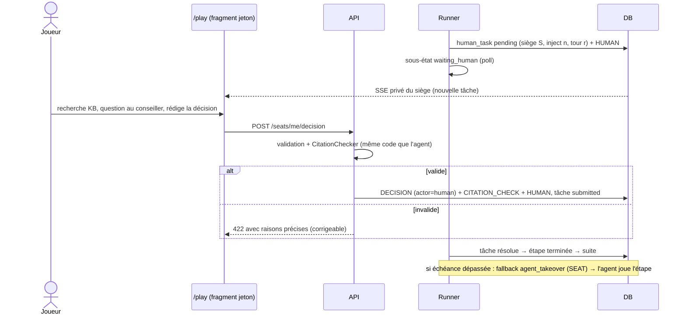

# 08 — Agents, outils, scénarios, moteur de simulation et interventions humaines

> Décisions : ADR 002 (boucle maison + enveloppe JSON), 003 (ledger = flux), 007 (fournisseurs). Pratiques : BP-14, 29, 31–33. Spécifications : Spec L326-380, L359-370 ; Simple l.312, l.358, l.439, l.680.

## 8.1 Acteurs de la simulation

| Acteur | Nature | Pilote | Remarque |
|---|---|---|---|
| **Institution** (`role_kind=institution`) | Agent LLM (ou humain) représentant une institution réelle, borné par son mandat et ses KB | `agents` | Nombre d'institutions : donnée du scénario |
| **Système IA testé** (`role_kind=ai_system`) | Système fictif dont les sorties sont **scénarisées** (`inject.system_output`) | `scenarios` | Jamais un LLM : son comportement fait partie de l'histoire (HydroSense dans la démo) |
| **Conseiller juridique** (`role_kind=legal_adviser`) | Agent LLM appelé via `ask_legal` ; ne reçoit pas d'inject | `agents` | Sortie en 4 parties |
| **Coordinateur (COORD)** | **Code déterministe**, pas un agent | `simulation` | Ouvre/clôt les tours, route, lève les signaux |
| **Animateur** | Humain (jeton `facilitator`) | API | Commandes : pause, reprise, pas, vitesse, surprise, correction, arrêt |
| **Joueur humain** | Humain sur un siège | API/SPA | Mêmes validations qu'un agent |
| **Observateur / auditeur** | Humain en lecture seule | API/SPA | Visibilité réglable |

## 8.2 Définition d'un agent et assemblage du contexte

| Champ | Rôle |
|---|---|
| `institution_id`, `code`, `name`, `role_kind` | Identité institutionnelle |
| `mission`, `instructions` | Texte libre rédigé par l'utilisateur (rôle, ton, contraintes, langue) |
| `model_profile_id` | Fournisseur + modèle + paramètres (température 0 par défaut) |
| `tools` | Sous-ensemble de `search_kb, ask_legal, post, decide` |
| `limits` | `max_steps` (4), `max_search_calls` (3), `max_legal_calls_per_inject` (2) |
| droits | `agent_kb_grant` (matrice « Knowledge Access Mapping ») |

**Prompt système assemblé par le backend** (modèle versionné dans `agents/prompts/`) — sections dans cet ordre, avec un budget total **≈ 4 000 tokens** :

1. *Rôle* : institution, mission, instructions utilisateur.
2. *Mandat documenté* : liste des mandats **validés** de l'institution actifs dans l'exercice (pouvoir/devoir, action, source `doc · article`) — l'agent « sait » ce que ses textes lui accordent, avec la référence ; **aucune lacune ni indice de lacune n'est jamais inclus** (règle d'intégrité I2).
3. *Règles de conduite* : n'agir que dans le mandat ; citer ou dire « aucune base juridique trouvée » (deux issues seulement) ; distinguer fait/déduction/hypothèse ; langue de réponse.
4. *Outils* : description et schéma d'enveloppe (§8.3).
5. *Contexte de l'activation* : nouveaux éléments de la boîte privée, derniers messages du tableau visibles du siège, décisions précédentes **du siège**, résultats de recherche de l'activation.
6. *Sécurité* : contenu récupéré = données non fiables (§7.4).

Aucun secret, aucune configuration critique dans le prompt (OWASP LLM08 : on suppose que tout ce que voit le modèle peut fuir).

## 8.3 Les quatre outils

L'agent répond à **chaque pas** par une *enveloppe d'action* JSON **plate** (schéma contraint côté serveur ; validation en union discriminée Pydantic côté backend — recommandation Opus : les `oneOf` sont mal supportés par certaines grammaires).

```json
{
  "action": "search_kb | ask_legal | post | decide",
  "rationale": "justification publique ≤ 280 caractères (pourquoi cette action)",
  "query": "…",                       // search_kb
  "question": "…",                    // ask_legal
  "to": "SEAT_CODE", "msg_type": "INFO|REQUEST|DECISION|OBJECTION|GAP_FLAG",
  "message": "…", "in_reply_to": "msg_id|null", "reply_status": "accepted|refused|not_our_role|null",   // post
  "decision": {                       // decide
    "action": "ce que l'institution fait ou refuse",
    "action_code": "code du catalogue ou null",
    "outcome": "act|decline|refer|no_legal_basis_found",
    "legal_basis": [{"chunk_id": "…", "article": "33|null", "quote": "≥ 20 caractères tirés du chunk"}],
    "confidence": "low|medium|high",
    "options_considered": ["…"],
    "gap_flags": [{"hint": "G1..G10|null", "text": "…"}],
    "evidence_tag": "documented|inferred|assumed"
  }
}
```

| Outil | But | Validation et autorisation (par le backend) | Effet | Événements | Limites |
|---|---|---|---|---|---|
| `search_kb(query)` | Chercher dans les KB **accordées** | `query` non vide ≤ 300 car. ; `SearchScope` du siège construit par le backend ; requêtes **dupliquées** détectées (renvoie le résultat précédent + avertissement) | Renvoie ≤ 5 `Hit` (chunk_id, titre, article, page, extrait, score) ajoutés au contexte | `TOOL_CALL`, `RETRIEVAL` | `max_search_calls` par activation |
| `ask_legal(question)` | Demander au conseiller une réponse 4 parties | Outil autorisé pour ce siège ; `question` ≤ 500 car. ; le conseiller utilise **son** `SearchScope` (par défaut toutes les KB de l'exercice) | Réponse en 4 parties + phrase de précaution, citations vérifiées ; **n'est jamais une décision** | `TOOL_CALL`, `LLM_CALL` (conseiller), `RETRIEVAL`, `CITATION_CHECK` | `max_legal_calls_per_inject` |
| `post(to, msg_type, message, …)` | Seul canal entre institutions | `to` ∈ sièges de l'exercice ≠ soi ; `msg_type` ∈ 5 types ; `reply_status` seulement si `in_reply_to` référence un REQUEST reçu ; taille ≤ 1 500 car. ; tour courant ≤ 2 | Ajoute `board_message` ; livre dans la boîte du destinataire (visibilité §8.9) | `TOOL_CALL`, `BOARD` | 2 tours par inject (COORD) |
| `decide(decision)` | Enregistrer une décision structurée | Pydantic strict ; `legal_basis` **obligatoire** sauf `outcome=no_legal_basis_found` ; **contrôle de citation** (§8.5) ; `action_code` ∈ catalogue ou `null` | Crée `decision` (+ citations) ; termine l'activation | `TOOL_CALL`, `DECISION`, `CITATION_CHECK` | Une décision par activation (+ 1 relance) |

Un humain utilise les **mêmes** validations via l'interface (§8.12).

## 8.4 Boucle d'activation (contrôlée par le backend)



**Garde-fous** : `max_steps` (4) ; dernier pas forcé à `post|decide` ; coupe-circuit si le pas répète la même requête ; budget par exercice `max_llm_calls` (défaut **199**, T6 : < 200) — au dépassement l'exercice passe en **pause** avec un `ERROR` « budget », jamais en boucle silencieuse ; délai d'appel configurable ; **repli déterministe** si le fournisseur est indisponible (`LLM_OUTAGE`) : l'activation produit une décision `outcome: refer`, `rationale: "fallback: model unavailable"`, `author=fallback`, et un `ERROR` ; ces décisions sont **exclues** des signaux d'analyse (elles n'attestent d'aucun comportement d'institution). **Distinction** : *fournisseur indisponible* → décision de repli `author=fallback` ; *sortie invalide deux fois* → **aucune décision d'institution** : une ligne `decision` avec `status=not_recorded` (visible), un `ERROR`, jamais de décision inventée.

## 8.5 Contrôle de citation (déterministe)

Entrée : `decision`, `retrieval_set(seat, inject)` (chunks renvoyés au siège pour cet inject), `scope(seat)`. Pour chaque élément de `legal_basis` :

| # | Contrôle | Échec si |
|---|---|---|
| 1 | Le `chunk_id` existe | inconnu |
| 2 | Le chunk appartient au `scope` du siège | hors droits (défense en profondeur) |
| 3 | Le chunk figure dans `retrieval_set` de cette activation | non récupéré |
| 4 | `article` cité = `chunk.article` (comparaison normalisée) ; `null` autorisé seulement si le chunk n'a pas d'article ; **la valeur « to confirm » est refusée** | incohérent |
| 5 | `quote` (normalisée : NFC, casse, espaces, ponctuation) est une **sous-chaîne** du texte normalisé du chunk, longueur ≥ 20 caractères | introuvable ou trop courte |
| 6 | Le document du chunk n'est pas `validity=replaced` (sauf exercice historique) | texte remplacé |

Résultat par citation : `pass | fail` + raison. Règles : 1 relance avec la raison ; si échec persistant → décision enregistrée avec `status=not_verified` (rouge, visible, comptée dans T2) — **jamais supprimée** (D-19). Le même `CitationChecker` sert aux réponses du conseiller et aux soumissions humaines. T2 = citations `pass` / citations totales.

## 8.6 Conseiller juridique (`ask_legal`)

Sortie validée (schéma strict) : `{ "what_the_texts_say": [{claim, cites[]}], "what_they_do_not_say": [{point, searched_queries[]}], "what_others_do": [{jurisdiction, instrument, summary, cites[]}], "what_to_check": [str], "closing": "For exercise purposes only; confirm with a qualified lawyer." }`. Contraintes : pas d'avis final ; chaque affirmation du bloc 1 et 3 porte une citation vérifiée ; « what_they_do_not_say » liste les requêtes tentées (alimente les **recherches négatives**, §9.5) ; la phrase de précaution est ajoutée par le code (formule unique FR/EN, D-32).

## 8.7 Fournisseurs de modèles (port `LLMProvider`)

```python
class LLMProvider(Protocol):
    name: str            # "openai_compat" | "scripted" | "cassette"
    ai_involved: bool    # False pour scripted ; cassette = True (réponses d'un modèle enregistré)
    def complete(self, messages: list[Msg], *, schema: dict | None, params: Params) -> RawCompletion: ...
```

| Fournisseur | Rôle | Détails |
|---|---|---|
| `openai_compat` | Production et dev avec un vrai modèle | `POST {base_url}/v1/chat/completions` ; `response_format: json_schema` (vLLM / Ollama compat) avec repli sur le champ natif `format` d'Ollama, puis sur « JSON dans le texte + extraction » ; température 0 ; `timeout` ; usage de tokens enregistré ; secrets uniquement par variables d'environnement (`ALERTE_LLM_BASE_URL`, clés) |
| `scripted` | Tests, CI, dev sans modèle, démonstration d'urgence | Réponses déterministes par règles (recherche → décision citant les meilleurs chunks du mandat, etc.) ; `ai_involved = False` ; **étiquette « SANS IA » obligatoire** : bannière dans la Room, champ dans le ledger (`STATE.ai_mode`), en-tête du rapport ; **ne peut jamais produire de lacune « observée par agents IA »** |
| `cassette` | Rejeu fidèle et démo sûre | Rejoue les `response_blob` d'un exercice enregistré, appariés par `(step_key, prompt_sha256)` ; si le prompt diverge → échec explicite (preuve de non-reproductibilité) ; **la ré-exécution complète reproduit le même `replay_digest`** (golden test ; la tête de chaîne diffère, voir doc 10 §10.3) |

Choix du modèle : décision V7 (doc 15). Les petits modèles (≤ 3B) décrochent en multi-tours ; les contraintes (enveloppe plate, 4 pas, contexte ≈ 4k tokens, relance unique) en tiennent compte. Un **taux d'échec de schéma < 5 %** sur 50 prompts de décision est exigé avant d'adopter un modèle.

## 8.8 Scénarios

| Entité | Contenu |
|---|---|
| `scenario` | Pays, langue, titre, description, version, statut (`draft \| ready \| archived`) |
| `inject` | `seq`, `sim_time` (étiquette du temps de l'histoire, ex. « J1 07:10 »), `title`, `body`, `from_actor`, **destinataires** (institutions), **demandes** (`inject_demand` → actions du catalogue), **étiquettes** (`life_risk`, `harm_possible`, `ai_output_used_in_decision`, `public_communication`, `channel_abuse`, `foreign_actor`, `time_critical`, …), `fault_mode`, `system_output` (sortie scénarisée du système IA testé), `source_note` |
| Branches (v2) | Un inject conditionnel à une décision précédente : **P2** |

**Demandes** : ce que la situation *exige* (« valider la prévision avant diffusion »). Elles ne sont **pas** des lacunes. Chaque action du catalogue porte `derivation` ; le rapport signale celles dérivées par l'auteur du scénario plutôt que d'un référentiel externe cité (risque de circularité n°1, doc 09 §9.9).

**Pannes injectées** (`fault_mode`) : `none`, `over_trust` (le système IA affirme avec trop de confiance), `degraded_inputs` (capteurs hors ligne), `misinformation` (fausse alerte relayée), `silent_institution` (un siège ne répond pas), `llm_outage` (le fournisseur échoue pour un tour). Catalogue extensible issu des 12 types de défaillance de la Spec (L275-290).

**Scenario Builder (UI)** : tableau ordonné d'injects (glisser pour réordonner), éditeur de fiche, sélecteur de destinataires (par institution), sélecteur de demandes (catalogue + création), étiquettes, pannes, aperçu « qui reçoit quoi » (matrice injects × sièges), import/export YAML (confort), lint en direct : inject sans destinataire, destinataire inexistant, action inconnue, inject adressé à tous (avertissement d'**inégalité d'information**), estimation du nombre d'appels LLM.

## 8.9 Exercise Readiness (contrôle de cohérence avant lancement)

| # | Contrôle | Niveau |
|---|---|---|
| 1 | Chaque siège a une institution et un contrôleur (agent ou humain) | Bloquant |
| 2 | Chaque agent a un profil de modèle valide ; un **appel de test** réussit (ou fournisseur `scripted` explicitement choisi) | Bloquant |
| 3 | Chaque agent a au moins une KB accordée (le conseiller : au moins une) ; les KB sont `ready` avec une **version publiée** | Bloquant |
| 4 | Chaque inject a ≥ 1 destinataire existant ; chaque demande référence une action du catalogue | Bloquant |
| 5 | Les institutions destinataires ont un siège dans l'exercice | Bloquant |
| 6 | Les mandats validés existent pour les institutions jouées (sinon : les agents n'auront aucune base) | Avertissement |
| 7 | Registre de mandats `reviewed_complete` pour les institutions (sinon les lacunes « documentées » seront rétrogradées) | Avertissement |
| 8 | Modèle d'embeddings cohérent entre KB et configuration (sinon **refus explicite** de la recherche ou ré-embedding de la KB — [07](07-knowledge-and-rag.md) §7.3) | Avertissement |
| 9 | Budget d'appels estimé ≤ plafond (`injects × destinataires × tours × pas`) | Avertissement / bloquant si > plafond × 1,5 |
| 10 | Documents `validity=replaced` ou `redistribution=unknown` présents dans le périmètre | Information |
| 11 | Langue des injects couverte par les KB des destinataires | Avertissement |
| 12 | Aucun jeton de siège humain sans humain nommé | Bloquant |

Lancement refusé tant qu'il reste un contrôle **bloquant** ; le résultat est enregistré dans le snapshot.

## 8.10 Cycle de vie d'un exercice



Sous-état de `running` : `waiting_human` (tâche humaine en attente), `advancing`, `idle_between_injects` (pace manuel). Table de transitions en code (BP-14) ; toute transition absente → `409`. Un exercice **lancé** ne peut plus être supprimé (archivé seulement) ; sa configuration ne peut plus être modifiée (snapshot).

| Commande (animateur) | États valides | Effet | Événement |
|---|---|---|---|
| `start` | ready | Fige le snapshot, écrit `SNAPSHOT` (hash) puis `STATE running` | `STATE` |
| `pause` / `resume` | running / paused | Drapeau lu **entre deux étapes** | `STATE`, `FACILITATOR` |
| `step` | paused ou pace manuel | Libère l'inject suivant et exécute ses tours | `FACILITATOR` |
| `speed` | running | Délai entre injects (`pace`: manuel, auto, auto + délai) | `FACILITATOR` |
| `surprise` | running/paused | Insère un inject ad hoc (marqué `surprise`) | `INJECT`, `FACILITATOR` |
| `seat_switch` | running/paused | Voir §8.12 | `SEAT` |
| `correction` | any started | Nouvelle entrée `CORRECTION` pointant vers l'entrée corrigée (rien n'est effacé) | `CORRECTION` |
| `stop` | running/paused | Clôture proprement, déclenche la détection finale | `STATE` |

## 8.11 Moteur : boucle d'exécution

```
run(exercise):                                     # dans un thread, un exercice
  for inject in scenario.injects (ordre seq) not yet closed:
      checkpoint()                                  # lit les commandes ; pause/stop/surprise
      release(inject)                               # INJECT au ledger ; remplit les boîtes des destinataires
      for round in 1..2:                            # 2 tours maximum (FR-31)
          for seat in order(seats_with_pending_items(inject, round)):   # ordre déterministe : seq des sièges
              step = f"inject:{n}:round:{r}:seat:{seat.code}"
              if step.done: continue                # idempotence / reprise
              result = activate(seat)               # agent  ─ ou ─  tâche humaine (attente)
              commit(step, events)                  # même transaction : métier + ledger
              checkpoint()
          COORD.close_round(inject, round)          # code : signaux, routage, REQUEST sans réponse…
          if COORD.nothing_pending(inject): break
      COORD.close_inject(inject)                    # 2e tour clos : demandes restantes → signaux
      hooks.on_inject_closed(exercise, inject)      # gaps.detect(...) – extension, pas d'import direct
  finalize(exercise)                                # détection finale, ancre de tête, état completed
```

**COORD (règles déterministes — Spec L370-378 et L568)** :

| Règle | Condition | Signal émis (événement `GAP`, `origin=coordinator`) |
|---|---|---|
| R-ORPHAN | Un `REQUEST` n'est pas accepté après 2 tours (aucune réponse `accepted`) | `ORPHAN_REQUEST` (candidat G1) |
| R-NOTOURROLE | Tous les destinataires d'une demande répondent `not_our_role` | `NO_OWNER` (G1) |
| R-OVERLAP | ≥ 2 sièges déclarent agir sur la même `action_code` (décisions `act`) sans réponse de chef de file | `CLAIM_OVERLAP` (G2) |
| R-CONFLICT | Deux décisions contradictoires sur la même action (outcomes opposés) | `CONFLICTING_DECISIONS` (G5) |
| R-NOBASIS | Une décision `no_legal_basis_found` | `MISSING_BASIS` (G1/G3) |
| R-CITEFAIL | Décision `not_verified` | `UNSUPPORTED_DECISION` (qualité, pas une lacune) |
| R-SILENT | Un siège destinataire n'a produit aucune décision | `NO_RESPONSE` (observation) |
| R-AIFLAG | Un `GAP_FLAG` d'agent | `AGENT_HYPOTHESIS` (jamais un constat, I1) |

Les signaux sont des **entrées** du module `gaps` (doc 09) ; COORD ne « conclut » jamais une lacune.

**Pas de pace en temps réel dans le moteur** : il n'y a pas d'horloge simulée qui court ; `sim_time` est l'étiquette de l'inject. `pace=auto` enchaîne les injects, `pace=manual` attend `step`.

**Reprise après arrêt anormal (FR-36)** : au démarrage, `running → interrupted` ; « Reprendre » relance le runner qui saute les `step` terminés et ré-exécute la première étape incomplète ; un appel LLM déjà enregistré (même `step_key`, même `prompt_sha256`) est relu depuis le blob (pas de nouvel appel). Une étape qui n'a pas commité n'a laissé aucun événement (transaction).



## 8.12 Interventions humaines

| Aspect | Conception |
|---|---|
| Affectation | Chaque siège : `controller ∈ agent \| human \| scripted`. Participant & Human Assignment : choisir le contrôleur, nommer l'humain, générer le **lien de siège** (jeton `player`, expiration, révocable) |
| Tâche humaine | Quand un siège humain doit agir, le runner crée une `human_task` (`pending`, échéance `deadline_at` configurable) et passe en sous-état `waiting_human` (événement `HUMAN`) |
| Interface joueur (`/play#t=<jeton>`, jeton dans le fragment d'URL) | Fiche de rôle, boîte **privée**, tableau, recherche KB limitée à **ses** droits (`SearchScope` du siège), bouton « Demander au conseiller », formulaire `post` et `decide` (mêmes champs et validations qu'un agent, contrôle de citation avant envoi, aperçu des erreurs) |
| Soumission | Validée, citations vérifiées, écrite au ledger avec `actor = human:<nom>` (événement `HUMAN` + `DECISION`/`BOARD`) |
| Échéance | `fallback`: `agent_takeover` (l'agent du siège reprend, événement `SEAT`), ou `skip` ; réglable par exercice ; l'animateur peut aussi prolonger |
| Transfert | `seat_switch` (agent→humain ou humain→agent) **entre deux activations** ; l'historique est dans `seat_assignment` ; l'IA qui reprend reçoit l'historique de **ce siège seulement** |
| Confidentialité | Un joueur ne voit jamais la boîte d'un autre siège ni le ledger pendant l'exercice (D-16) |



## 8.13 Visibilité des événements (rôles)

| `visibility` | Qui le voit | Exemples |
|---|---|---|
| `public` | Tous les rôles, y compris observateur « public seulement » | INJECT publics, DECISION publiées, GAP validés, STATE |
| `board` | Sièges, animateur, auditeur, observateur « tout » | BOARD |
| `seat:<id>` | Ce siège (et animateur/auditeur) | Boîte privée, RETRIEVAL, TOOL_CALL du siège, tâche humaine |
| `audit` | Animateur et auditeur seulement | LLM_CALL complet, CITATION_CHECK détaillé, ERROR, CORRECTION |

Le flux SSE applique ce filtre **côté serveur** selon le jeton (jamais côté client).

## 8.14 Rejeu

| Mode | Principe | Usage |
|---|---|---|
| (a) **Rejeu de lecture** | Reconstruit l'état à l'instant *t* depuis le ledger (ce que chaque siège savait) ; curseur temporel ; aucun appel de modèle | Page Audit/Replay (Spec p.7) |
| (b) **Ré-exécution cassette** | Relance le moteur avec `cassette` sur le même snapshot ; compare le `replay_digest` final à celui enregistré | Test de reproductibilité ; **démo sûre hors Sandbox** |
