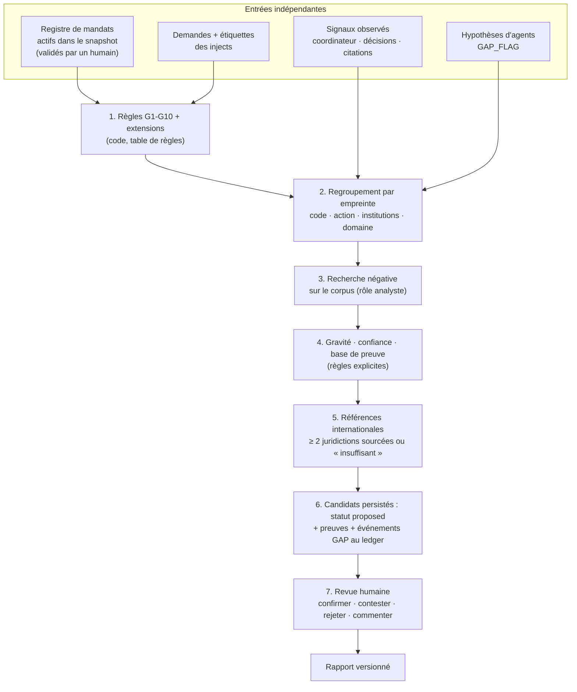
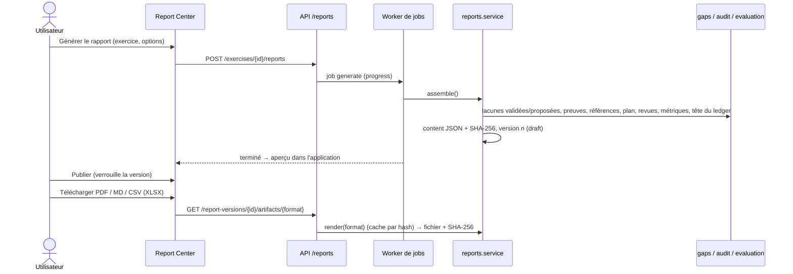

# 09 — Gap Analysis, références internationales et gestionnaire de rapports

> C'est le **cœur de la valeur d'ALERTE**. Modèle de données : doc 06 §6.1 et §6.4. Règles d'intégrité I1–I7 : doc 01 §1.2. Méthodes : HSEEP (AAR/IP), EW4All, CAP, IFRC IDRL (annexe [A7](appendix/A7-research-hackathon-and-methods.md), niveau de vérification indiqué là-bas).

## 9.1 Pipeline de détection

Déclenchement : après **chaque inject clos** (détection incrémentale, pour que la Room montre les lacunes naissantes) et **à la fin de l'exercice** (détection finale, dédoublonnage). Exécution : fonction pure `detect(snapshot, registry, demands, events) -> [GapCandidate]` (testable sans moteur ni modèle).

## 9.2 Typologie : 17 catégories (brief) ↔ règles G1–G10 (Spec)

`code` (famille de règle) et `category` (typologie) sont deux axes distincts : le code dit **quelle règle** a déclenché ; la catégorie dit **de quel type de lacune** il s'agit (filtre de la page Gap Analysis).

| Catégorie (brief U §7.2) | Règle(s) / signal | Prio |
|---|---|---|
| Mandat institutionnel absent ou incomplet | **G1** Orphan responsibility ; signal `NO_OWNER`/`MISSING_BASIS` | P0 |
| Responsabilité institutionnelle ambiguë | **G2** (lead absent), `CLAIM_OVERLAP` | P0 |
| Chevauchement des responsabilités | **G2** Overlapping mandate | P0 |
| Contradiction entre les mandats | **G5** Conflict of objectives ; signal `CONFLICTING_DECISIONS` | P1 |
| Absence de mécanisme de coordination | Signal `ORPHAN_REQUEST` (P0) ; G2/G3 ; mandat `coordination` absent (P1) | P0 |
| Déficit de partage d'information | Règle **X1** : mandat `information_sharing` absent entre détenteurs d'actions liées | P1 |
| Lacune réglementaire | **G3** Missing procedure ; **G4** Dependency on a missing piece | P0 (G3) · P1 (G4) |
| Lacune législative | **G1/G6** sur texte de rang loi (champ `doc_type` des sources) | P1 |
| Lacune de politique publique | Règle X1/X2 sur documents `strategy`/`policy` | P2 |
| Lacune de standardisation | Références (CAP, Y.3172) + signal d'agent corroboré ; pas de règle G dédiée | P2 |
| Lacune technique | Signal `AGENT_HYPOTHESIS` de type technique **ou** recherche négative d'un standard ; catégorie `technical_capacity` (extension **X2**, hors G1–G10 — proposition de l'annexe A7) | P2 |
| Lacune opérationnelle | Signaux `NO_RESPONSE`, `ORPHAN_REQUEST`, délai non tenu | P1 |
| Lacune de gouvernance | **G2** (P0) ; **G6** (responsabilité), **G7** (inclusion) (P1) | P0/P1 |
| Lacune de capacité institutionnelle | Extension **X2** (signal d'agent confirmé par une 2e source) | P2 |
| Lacune d'interopérabilité | **G10** Cross-border, règle X3 | P1/P2 |
| Lacune de mécanismes de supervision | **G8** AI oversight gap | P0 |
| Lacune de préparation ou de réponse à une crise | Combinaison G1+G3 sur actions `time_critical` (P0) ; **G9** Security gap (P1) | P0/P1 |

## 9.3 Règles G1–G10 : définition exécutable

Les règles sont des **entrées d'une table** (`gap_rule`), chacune = prédicat sur le registre de mandats actif + demandes + étiquettes d'inject, pas du code éparpillé. Vocabulaire : `holders(action, kinds)` = institutions ayant un mandat *validé* de l'un des `kind` pour l'`action_id` (ou le `domain`) ; `M` = registre actif (mandats dont la version de document source ∈ snapshot).

| Code | Nom (Spec L553-564) | Déclenchement (par inject, pour chaque demande `action`) | Étiquettes requises | Gravité par défaut |
|---|---|---|---|---|
| **G1** | Orphan responsibility | `holders(action, {power, duty}) = ∅` | — | 3 si `life_risk`/`rights_risk`, sinon 2 |
| **G2** | Overlapping mandate | `\|holders(action, {power})\| ≥ 2` **et** aucun mandat `lead` pour l'action | — | 2 ; 3 si `time_critical` et `life_risk` |
| **G3** | Missing procedure | `holders ≠ ∅` et tous leurs mandats ont `procedure_status ∈ {none, general, unknown}` ou `has_deadline=false` avec `time_critical` | — | 2 ; 3 si `life_risk` |
| **G4** | Dependency on a missing piece | un mandat de `holders` a `dependency_text` non résolu (`depends_on` absent ou dont la source est introuvable/`replaced`) | — | 2 |
| **G5** | Conflict of objectives | deux mandats `duty` liés par `conflicts_with` sont tous deux déclenchés par les demandes de l'inject | — | 2 |
| **G6** | Liability gap | pas de mandat `liability` pour l'action/le domaine | `harm_possible` | 3 si `life_risk`/`rights_risk`, sinon 2 |
| **G7** | Inclusion gap | pas de mandat `inclusion` (langues, accessibilité, canal non téléphonique) pour l'action/le domaine | `public_communication` | 1 ; 2 si `life_risk` |
| **G8** | AI oversight gap | pas de mandat `human_oversight` couvrant l'action où l'**output du système IA** est utilisé | `ai_output_used_in_decision` | 3 si `life_risk`, sinon 2 |
| **G9** | Security gap | pas de mandat `channel_protection` | `channel_abuse` | 2 ; 3 si `life_risk` |
| **G10** | Cross-border gap | pas de mandat `international_agreement` pour l'action | `foreign_actor` | 2 |

Remarques :
* Les règles n'emploient **aucun nom de pays ni d'institution** : elles lisent des `kind`, des actions et des étiquettes (généricité, U§3).
* **Condition d'intégrité du registre** : si pour les institutions concernées `registry_review.status ≠ reviewed_complete`, une absence produit un candidat d'`evidence_basis = inferred` (« registre incomplet ») et jamais `documented` ; `gap.registry_state` conserve l'état.
* Les mandats `proposed` (non validés) comptent comme **faible** : ils empêchent le déclenchement automatique d'un G1 « documenté » mais le gap est créé avec `confidence=low` et la mention « mandat proposé non validé ».
* P0 implémente G1, G2, G3, G8 ; P1 : G4–G7, G9, G10 ; X1–X3 : P1/P2 (voir §9.2).

### Signaux observés → candidats

| Signal (doc 08 §8.11) | Candidat | `evidence_basis` |
|---|---|---|
| `ORPHAN_REQUEST`, `NO_OWNER` | G1 (+ catégorie coordination) | `observed` (renforce un G1 documentaire ; seul : `inferred`) |
| `CLAIM_OVERLAP` | G2 | `observed` |
| `CONFLICTING_DECISIONS` | G5 | `observed` |
| `MISSING_BASIS` | G1/G3 (selon registre) | `observed` + recherche négative |
| `NO_RESPONSE` | Observation opérationnelle | `observed` |
| `AGENT_HYPOTHESIS` | Hypothèse | `hypothesis` (section séparée du rapport) |
| `UNSUPPORTED_DECISION` | Aucun (qualité T2) | — |

**Règle de promotion** : un candidat n'entre dans la section « Constats » du rapport que s'il a **au moins une preuve non-agent** (mandat/règle documentaire, ou signal du coordinateur corroboré). Sinon : « Hypothèses ».

## 9.4 Base de preuve, confiance, gravité

| Axe | Valeurs | Règle |
|---|---|---|
| `evidence_basis` | `documented` (règle + registre `reviewed_complete` + recherche négative sans contre-preuve) · `observed` (signal du coordinateur en simulation) · `inferred` (règle sur registre incomplet/proposé, ou un signal seul) · `hypothesis` (agent seul) | Calculée par le moteur ; l'humain ne peut pas la « relever » sans revue consignée |
| `confidence` | `high` : `documented` **et** corroboré par un signal observé ; `medium` : `documented` seul ou `observed` + registre partiel ; `low` : le reste | Règle écrite, testée |
| `severity` (1-3) | 1 = gêne ; 2 = retard/surcoût/mauvaise coordination ; 3 = risque pour la vie ou les droits (Spec L570) | Table §9.3 + étiquettes de l'inject ; modifiable par revue avec motif |
| `validation_status` | `proposed → confirmed \| disputed \| rejected` (+ `reopened`) | **Seule** une revue humaine peut le modifier (D-06) ; l'axe n'est jamais fusionné avec la confiance |

## 9.5 Protocole de recherche négative

Pour chaque candidat « absence » (G1, G3, G6–G10) : (1) générer des requêtes standardisées depuis le libellé de l'action et les synonymes configurés, **dans chaque langue** des KB concernées ; (2) lancer `search` avec un `SearchScope` **analyste** (toutes les KB nationales de l'exercice, pas seulement celles de l'agent) ; (3) enregistrer `negative_search` (requêtes, langues, nb de documents du corpus, meilleurs scores) ; (4) si un hit dépasse le seuil → **contre-preuve** attachée (`role=counter`) et le candidat est rétrogradé (`inferred`) plutôt que supprimé. Formulation imposée dans l'UI et le rapport : « *non trouvé dans le corpus K (N documents ; langues L ; requêtes Q)* ». Limite assumée : une recherche lexicale peut manquer un synonyme ; d'où la revue humaine et l'état `reviewed_complete` du registre.

## 9.6 Références internationales et précédents

| Élément | Conception |
|---|---|
| Bibliothèque | `international_reference` : juridiction, instrument, article, résumé, `binding`, domaines, codes de lacune concernés ; **chaque entrée référence un chunk** d'une KB `global_practices` (ou, à défaut, une URL avec `evidence_tag=summary` marqué) — pas d'entrée sans source (I4) |
| Amorçage | Re-saisie de l'ancien `precedents.yaml` (21 actions) **avec identifiants réalignés sur les documents réellement présents** (l'ancien lien `GL-S0x` ne correspondait plus à l'index, A3/diagnostic) |
| Appariement | (1) filtre par `gap_codes`/`domain` ; (2) requête hybride `description` + `action` sur les KB `global_practices` (P1) ; (3) score = tags + retrieval ; (4) l'utilisateur accepte/refuse chaque suggestion (`gap_reference.status`) |
| Exigence | **≥ 2 juridictions distinctes** par lacune confirmée ; sinon `gap_reference` indique `insufficient_sources` et l'UI/rapport l'affichent (« sources internationales insuffisantes : 1 trouvée »). Aucune entrée n'est fabriquée pour atteindre le nombre |
| Note d'adéquation | Générée par LLM (P1) **uniquement** à partir des chunks cités, avec contrôle de citation ; en P0 : saisie/validation humaine |
| Cadres de domaine | Rattachement des lacunes à des cadres reconnus : EW4All (4 piliers ; rattachement du pilier 3 « diffusion » à l'ITU : source secondaire [S], non lue), CAP 1.2, IFRC IDRL, HSEEP (A7) — **à lire avant de citer des clauses** (niveau [S] dans A7) |
| Distinction | Le rapport sépare « constat national » et « bonne pratique mondiale » (critère officiel : domaines et exemples mondiaux, pas recommandations géographiques) |
| Vérification indépendante | Comparaison avec la liste de lacunes de l'IFRC (CM-12) : `evaluation` (P2), sans seuil |

## 9.7 Revue humaine et gestion depuis l'interface

```mermaid
stateDiagram-v2
  [*] --> proposed: détection (règle / signal)
  proposed --> confirmed: confirmer (avec commentaire)
  proposed --> disputed: contester (motif obligatoire)
  proposed --> rejected: rejeter (motif obligatoire)
  disputed --> confirmed
  disputed --> rejected
  confirmed --> disputed
  rejected --> proposed: réouvrir
  confirmed --> [*]
```

* Toute transition crée une ligne **append-only** `gap_review` (qui, quoi, quand, `from→to`, `reality_label` ∈ real/partially_real/not_real, commentaire). Une lacune `rejected` reste dans la base et le ledger mais **sort du résumé** du rapport (Simple l.702-703).
* **Page Gap Analysis & Institutional Assessment** : tableau filtrable (pays, institution, domaine, catégorie, code G, gravité, confiance, base de preuve, statut, origine) ; panneau de détail avec **chaîne de preuves cliquable** : mandat → texte (page/article/extrait) → événement du scénario → message(s) → décision(s) ; recherches négatives ; références et précédents ; historique de revue ; observations ; actions d'amélioration (propriétaire, échéance, statut, KPI — HSEEP IP) ; comparaison avec d'autres exercices (nouvelle / persistante / résolue / sévérité modifiée, par `fingerprint`).
* **Recommandations ≠ observations** (HSEEP) : l'observation est dans le constat ; les recommandations proposées sont dans `improvement_action` et la section « Plan d'amélioration ».

## 9.8 Registre de mandats (alimente les règles)

| Fonction | P0 | P1 |
|---|---|---|
| Création manuelle d'un mandat dans l'UI : institution, `kind`, action, description, **source** choisie par recherche dans la KB (doc, article, page, extrait copié depuis le chunk) | ✔ | |
| Import CSV (les ~31 lignes de l'ancien `ae_mandates.csv`/`cm_mandates.csv`), statut `proposed` ; **les sources à re-lier** (anciens `source_doc` morts) | ✔ | |
| Validation ligne par ligne : accepter / corriger / rejeter (Simple l.354) | ✔ | |
| Revue de couverture par institution (`reviewed_complete`) | ✔ | |
| Extraction **proposée par LLM** à partir des chunks (JSON contraint) puis validation humaine | | P2 |
| Visualisation du graphe de mandats (NetworkX → vue) | | P2 |

Un mandat sans source résolvable est **inactif** (test CI : `mandate_source.chunk_id` doit exister). L'amorçage des démonstrations passe par des **données saisies/importées dans l'interface**, pas par des constantes du code.

## 9.9 Garde-fous contre la circularité (réponse aux risques identifiés)

| # | Où la circularité peut revenir | Mitigation | Preuve |
|---|---|---|---|
| 1 | Les `required_actions` encodent les lacunes | `derivation` obligatoire (`referential` avec `reference_note` citée, `scenario_author`, `agent_proposed`) ; le rapport liste la part « dérivée de l'auteur » ; les actions de référence sont **commitées avant** la construction du registre | Table dans le rapport ; hash des demandes dans le snapshot |
| 2 | Registre curé par l'équipe ⇒ toute absence = lacune « par construction » | Étiquette honnête : analyse documentaire (`documented`) ≠ `observed` ; condition `reviewed_complete` ; recherche négative avec contre-preuve | Champ `registry_state` visible |
| 3 | Les prompts d'agent révèlent le gap | Prompts sans mention de lacune ; revue du modèle de prompt ; test : le prompt ne contient aucun `fixture` ni code G | Test automatique |
| 4 | Démo en `scripted` ⇒ lacunes littéralement pré-écrites | Étiquette « SANS IA » ; en `scripted`, les signaux sont marqués `scripted` et **exclus** de `evidence_basis=observed` ; la démonstration de référence est un exercice **cassette d'un vrai modèle** | Bannière + champ ledger |
| 5 | Bibliothèque de précédents curée pour les lacunes attendues | Entrées exigent un chunk source ; revue par rapport au référentiel ; « sources insuffisantes » affiché | Test I4 |
| 6 | Recherche négative lexicale ≠ absence juridique | Formulation « non trouvé dans le corpus K » ; couverture consignée ; revue humaine | Rapport |
| 7 | Les fixtures T3 fuient dans le détecteur | `evaluation.fixtures` privé (test d'import) ; fixtures **scellées** (SHA-256 + date) avant les runs ; le conteneur de production exclut le répertoire des fixtures ; rapport : lacunes **nouvelles** (hors fixtures) et fixtures **manquées** (rappel honnête) | Test d'architecture + rapport |

### Garde-fous renforcés d'indépendance (corrections ciblées)

| # | Exigence | Mécanisme |
|---|---|---|
| 8 | **Provenance des actions attendues** | Chaque action porte `derivation` ∈ `referential` (référence citée et vérifiable → « attente documentée »), `scenario_author` (« attente fixée par le concepteur du scénario » — **jamais** « obligation institutionnelle officielle »), `agent_proposed` ; une **justification** est obligatoire ; privilégier les référentiels internationaux ; les demandes saisies par le concepteur restent **identifiables** dans l'UI et le rapport |
| 9 | **Registre vérifiable** | Chaque mandat est lié à un chunk réel (test CI) ; validation humaine ; **une institution dont le registre n'est pas `reviewed_complete` ne peut jamais être décrite comme « sans mandat »** (au mieux : candidat « registre non revu ») |
| 10 | **Couverture documentaire** | Liste *attendue* saisie par l'utilisateur (`kb_expected_document`) ; ratio présent/attendu affiché avec **toute** affirmation d'absence ; une absence dans une base incomplète n'est jamais une preuve d'inexistence |
| 11 | **Cause** | `gap.cause` ∈ `institutional` · `documentary` (couverture insuffisante) · `artifact` (le document pertinent était **dans la portée mais n'a pas été récupéré** : échec de retrieval, pas lacune institutionnelle) · `undetermined` |
| 12 | **Pré-engagement** | `exercise.commitment_sha256` (règles + demandes + version du registre + catalogue d'actions) inscrit au premier événement du ledger : aucun réglage a posteriori |
| 13 | **Détection indépendante** | Fixtures T3 cachées et scellées ; **scénarios de validation indépendants** rédigés par une 2e personne ; **contrôle négatif** (mandats complets → ≈ 0 lacune, taux de faux positifs publié) ; **benchmark externe** (IFRC, EW4All, catégories AI Readiness) ; **tests d'ablation** (corpus, registre) ; **variance** (≥ 3 exécutions ; les lacunes issues de règles doivent être identiques quel que soit le modèle) ; **relecture aveugle** par 2 relecteurs → précision avec intervalle de confiance et κ |
| 14 | **Nature des résultats** | Toujours distinguées : hypothèse d'agent (`hypothesis`), signal observé (`observed`), lacune déduite par règle (`inferred`/règle), soutenue par les documents (`documented`), **validée / contestée / rejetée** (`validation_status`) ; les signaux d'un run `scripted` ne comptent **jamais** comme `observed` |

Le test d'ablation/contrefactuel ci-dessous est utile mais **ne prouve pas à lui seul** l'absence de pré-programmation : le registre et les demandes restent des saisies humaines, d'où les garde-fous 8 à 14, présentés avec dénominateurs, intervalles de confiance et κ.

### Test contrefactuel (démonstration phare)

1. Exercice A : KB sans texte donnant l'action X à une institution → lacune G1 *proposée* avec preuves.
2. Importer/ajouter un document qui confère le mandat (nouvelle `kb_version`), valider le mandat correspondant → exercice B (même scénario, cloné avec `parent_exercise_id`) → la lacune **disparaît**.
3. Retirer le document → elle **revient**. Le scénario n'a pas changé ; seul le corpus a changé : **la détection dépend du corpus** (limite : registre et demandes restent des saisies humaines, voir garde-fous 1-2).
4. Le scénario **jumeau** (même histoire, deux pays) montre des lacunes différentes.

## 9.10 Gestionnaire de rapports

### Deux capacités distinctes

| | A. Rapports existants (importés) | B. Nouveaux rapports (générés) |
|---|---|---|
| Entrée | PDF/DOCX/MD déposé (ex. `ALERTE_Technical_Report_v2.pdf`, section 6 : 6 lacunes de politique + 5 de standards) | Un exercice terminé (ou en cours) |
| Stockage | Original conservé comme document d'une KB `prior_reports` (hash, provenance, date) | `report` + `report_version` immuables |
| Extraction | Saisie structurée assistée (P1) : l'utilisateur crée des `imported_finding` (titre, texte, code probable, page) à côté du document ; extraction LLM + validation en P2 | Assemblage automatique depuis `gap`, `audit`, `evaluation` |
| Statut | **Origine « analyse antérieure »** (bandeau, jamais mêlée aux lacunes générées) | Origine « généré par l'exercice X, version n » |
| Lien | `gap_prior_link` : *previously_identified / newly_emerged / contradicts* | Idem (comparaison) |

### Structure du rapport généré (inspirée de l'AAR/IP HSEEP — BP-36)

| § | Rubrique | Source |
|---|---|---|
| 0 | Page de garde et **intégrité** : exercice, version du rapport, hash du snapshot, **tête du ledger (seq, hash)**, mode `SANS IA`/avec IA, date | `exercise`, `audit` |
| 1 | Résumé exécutif (chiffres : lacunes par gravité/statut, décisions, citations vérifiées) | calcul |
| 2 | Contexte de l'exercice : pays, institutions et sièges (agent/humain), scénario, versions de KB, modèles | snapshot |
| 3 | Méthodologie : règles utilisées, niveaux de preuve, recherche négative, étiquetage IA, ce qui est « constat » vs « hypothèse » | statique + config |
| 4 | **Constats** (observations) par gravité : id, titre, description, type/catégorie, domaine, institutions, mandats, **sources** (doc, article, page, extrait), événements, messages, décisions, conséquences, confiance, base de preuve, statut de validation | `gap` + `gap_evidence` |
| 5 | Hypothèses non confirmées (agents) | `gap.origin=agent_hypothesis` |
| 6 | Références et précédents internationaux (par lacune ; « sources insuffisantes » si < 2) | `gap_reference` |
| 7 | **Plan d'amélioration** (recommandations ; propriétaire, échéance, statut, KPI) — distinct des constats | `improvement_action` |
| 8 | Validations et contestations humaines (synthèse + historique) | `gap_review` |
| 9 | Scorecard (13 dimensions, « non évalué » explicite) | `assessment` |
| 10 | Métriques T1–T6 (calculées ou « non calculé ») | `eval_run` |
| 11 | Limites de l'analyse (corpus, langues, OCR, absence ≠ inexistence, mode scripted, exercices fictifs) | statique + données |
| A | Annexes : index des preuves, inventaire des KB avec licences, vérification du ledger | — |

### Versions, formats, comparaison

* Une `report_version` est un **JSON structuré immuable** une fois `published` (brouillon modifiable avant) ; toute modification (nouvelle revue de lacune, correction) produit une **nouvelle version** liée à la précédente (`parent_version_id`).
* **Rendus** (dérivés du JSON, jamais modifiés à la main) : **Markdown canonique** (P0), **JSON** (P0), **CSV** de la liste des lacunes (P0), **PDF** (P1 ; repli P0 : page HTML d'impression « Enregistrer en PDF » ; décision V3), **XLSX** multi-feuilles (lacunes, preuves, références, plan, revues) (P2). Chaque artefact : SHA-256 + taille enregistrés ; le PDF/MD affichent la tête du ledger.
* **Comparaison** : de deux versions d'un même rapport (diff structurel) ou de **deux exercices** (par `fingerprint` : nouvelle, persistante, résolue, sévérité/statut modifiés) ; vue côte à côte pour des scénarios jumeaux (CM/AE).
* **Report Center** : liste des rapports (générés/importés), versions, publier, télécharger (format au choix), comparer, ouvrir la page de preuves liée.

## 9.11 Scorecard : 13 dimensions de l'AI Readiness ITU

| Aspect | Conception |
|---|---|
| Source de la grille | `rubric_dimension` (13) amorcée depuis `alerte/data/framework/dimensions.json` **après relecture contre le rapport ITU v2.0** (voir doc 03 §3.4) ; 3–5 `rubric_criterion` par dimension (question oui/partiel/non à vérifier dans les documents/le déroulé) |
| Indépendance | Les critères sont évalués **sans consulter la liste des lacunes** ; réponse = `yes \| partial \| no \| not_assessed` + preuves (chunks, événements) ; assesseur : `manual` (P0) ou `llm_judge` (P1, avec contrôle de citation, juge ≠ modèle des agents si possible), puis relecture humaine |
| Calcul | `score(dim) = Σ(poids × valeur) / Σ(poids évalués)` sur l'échelle 0–5 ; dimension sans critère évalué = **« non évalué »** (jamais 0) |
| Lien aux lacunes | Chaque lacune peut être **associée** à des dimensions (affichage croisé), sans servir au calcul du score |
| UI | Radar + tableau avec preuves ; côte à côte pour les jumeaux (Spec UI p.6) |
