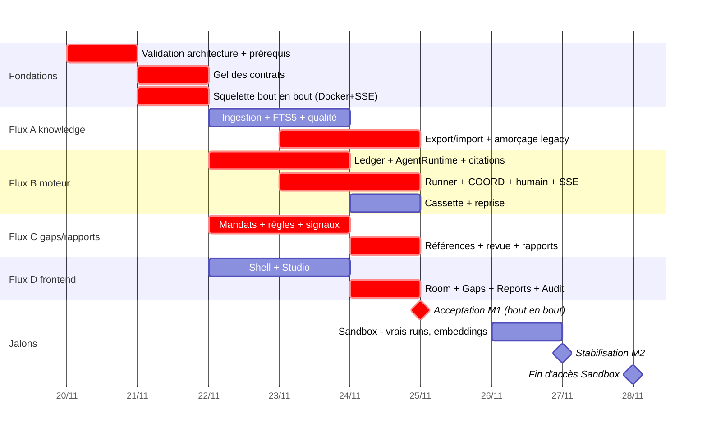

# 14 — Plan d'implémentation, chemin critique et organisation des agents

> Aujourd'hui : **vendredi 20 nov. 2026** (soir). Échéances : **mercredi 25 nov.** version fonctionnelle de bout en bout ; **28 nov.** fin d'accès au Sandbox ; finale à Dubaï **8 ou 9 déc.** (à confirmer). Le plan suppose **aucune** disponibilité d'un GPU avant d'avoir confirmé les ressources Sandbox.

## 14.1 Franchement : ce que ce calendrier permet

Cinq jours pour une plateforme à dix modules est **extrêmement serré**. Le plan ne tient que si (a) le périmètre P0 est tenu strictement ; (b) les contrats sont figés samedi matin ; (c) le travail est parallélisé en quatre flux ; (d) vous validez vite. Tout ce qui n'est pas P0 est **documenté, conçu et reporté**, pas supprimé des exigences. En cas de retard, l'ordre de coupe est défini (§14.6). Le risque principal n'est pas le code : c'est **l'absence de modèle réel** sur cette machine et l'inconnue du Sandbox.

## 14.2 Périmètre par priorité

| Priorité | Contenu |
|---|---|
| **P0** (mercredi 25) | Un espace, pays/institutions ; **KB** : upload PDF/MD/TXT, ingestion, **embeddings réels + index vectoriel + FTS5 + fusion RRF (RAG hybride)**, qualité, versions, **export/import ZIP vérifié** ; registre de mandats (saisie + import CSV + validation) ; agents + **matrice agents×KB appliquée côté serveur** ; scénario (éditeur UI) ; exercice : snapshot, readiness, **runner**, 2 tours, COORD, 4 outils, citations ; **siège humain** ; pause/reprise/arrêt/pas ; **ledger chaîné + ancre + vérification** ; SSE ; Room ; **lacunes** G1, G2, G3, G8 + signaux, preuves, recherche négative, revue humaine, références curées (≥ 2 juridictions ou « insuffisant ») ; **rapport MD/CSV/JSON + page d'impression** ; T2, T6 ; fournisseurs `openai_compat`, `scripted`, `cassette` ; **cassette** : un run avec un **vrai modèle** enregistré est visé pour M1 *si* un modèle utilisable est disponible (décision V7) ; sinon M1 est validé en `scripted` **explicitement étiqueté « SANS IA »** et le run réel est le jalon **M1b (jeudi 26, Sandbox)** |
| **P1** (jeudi 26 – vendredi 27) | G4–G7, G9, G10 ; PDF serveur ; comparaison de rapports/exercices ; import de rapports antérieurs ; reprise après crash complète ; vitesse/surprise ; observateur ; juge de scorecard ; T1, T3, T4, T5 ; DOCX/CSV ; interface en français ; plan d'amélioration ; ancre signée ; Alembic baseline |
| **P2** | XLSX ; extraction de mandats par LLM ; graphe de mandats ; Slack ; benchmark IFRC ; reranker ; Contextual Retrieval ; branches d'injects |

## 14.3 Calendrier

| Jour | Objectif | Livrables / critères de sortie |
|---|---|---|
| **Ven 20 (soir)** | Validation de ce dossier ; prérequis (Node, branche Git, contact organisateurs, modèle test) | Décisions V1–V8 de [15](15-decisions-to-validate.md) |
| **Sam 21 matin** | **Gel des contrats** (coordinateur seul, ≈ 4 h) : modèles + DTOs, catalogue d'événements, OpenAPI stub, ports, scénario golden | Dossier `contracts/` mergé ; types TS générés |
| **Sam 21 après-midi** | **Squelette de bout en bout** : 1 événement → ledger → SSE → 1 page (venv Python + Node/nvm ; image Docker optionnelle) | l'application démarre en local et affiche un événement en direct ; CI verte sur ubuntu/windows/macos |
| **Dim 22** | Flux A : workspaces + KB (ingestion, embeddings, index vectoriel + FTS5, upload, qualité). Flux B : ledger, `AgentRuntime`, outils, citations, fournisseurs. Flux C : mandats + règles G1/G2/G3/G8. Flux D : shell React + Country/KB Manager | Tests unitaires verts par module ; golden run `scripted` partiel |
| **Lun 23** | A : export/import d'archive + amorçage legacy. B : runner, COORD, état, SSE, siège humain. C : signaux, recherche négative, références, revue. D : Agents, Access matrix, Scenario Builder, Readiness, Room | **Golden run complet** `scripted` ; premier appel à un **vrai modèle et de vrais embeddings** sur la machine d'équipe |
| **Mar 24** | C : rapports + évaluation T2/T6 + scorecard manuelle. D : Gap Analysis, Report Center, Audit, Player Seat. B : pause/reprise/cassette. **Gel des fonctionnalités P0 et du modèle de données à 12 h** ; intégration ; sécurité (11 tests) | Branche d'intégration verte ; **Alembic baseline générée au gel** (si retard : reportée, `create_all` conservé) |
| **Mer 25** | **Acceptation de bout en bout** (§13.3, 15 étapes) ; données de démonstration (pays/institutions/KB via l'UI + archives) ; correctifs | **Jalon M1** : parcours complet opérationnel ; **les fonctionnalités IA ne sont validées qu'avec un run réel** (modèle + embeddings réels, machine d'équipe) ; `scripted` étiqueté « SANS IA » pour les tests uniquement |
| **Jeu 26** | Déploiement Sandbox (**après** validation locale) ; P1 prioritaires (PDF, comparaison) | Application déployée ; exercices réels ; cassettes |
| **Ven 27** | Stabilisation ; mesures T1–T6 ; kit de démo ; documentation | **Jalon M2** : stabilisé, kit exporté |
| **Sam 28** | Fin d'accès Sandbox : **exports finaux uniquement** (KB+embeddings, cassettes, rapports) | Aucune nouvelle fonctionnalité |
| 29 nov – 7 déc | Répétition de la démo ; rapport technique 5 pages ; vidéo ≤ 7 min (si retenu) ; corrections | Hors plateforme |

## 14.4 Chemin critique



Chemin critique : **contrats → ledger/AgentRuntime → runner → détection de lacunes → rapport → acceptation → Sandbox**. Le flux D (frontend) dépend des **fixtures OpenAPI** du samedi, pas du backend terminé.

## 14.5 Flux de travail parallèles et propriété du code

| Flux | Packages possédés | Dépend de |
|---|---|---|
| **A — Knowledge** | `core` (hors contrats), `workspaces`, `mandates` (modèle/CRUD), `knowledge`, scripts d'import legacy | contrats |
| **B — Moteur** | `agents`, `audit`, `simulation`, `scenarios` | contrats, `search()` (stub puis A) |
| **C — Analyse** | `gaps`, `mandates` (règles/graphe), `reports`, `evaluation` | contrats, événements du ledger (catalogue) |
| **D — Frontend** | `frontend/` | OpenAPI (fixtures) |
| **Coordinateur** | `contracts`, intégration, merges quotidiens, `docs/` | tous |

Règles : **un worktree par flux** ; interdiction de modifier un package possédé par un autre flux (changement demandé au propriétaire ou au coordinateur) ; **merge quotidien** par le coordinateur ; le **golden run** doit rester vert ; revue **indépendante** quotidienne par l'agent `audit`.

## 14.6 Ordre de coupe en cas de retard (décidé à l'avance)

1. XLSX, graphe, extraction LLM (déjà P2) → 2. PDF serveur (reste la page d'impression) → 3. Comparaison de rapports → 4. Import de rapports antérieurs → 5. Scorecard automatique → 6. Vitesse/surprise → 7. Observateur → 8. Reprise après crash (reste : « reprendre depuis le journal » manuel) → 9. Interface FR. **Jamais coupés** : **recherche hybride réelle (embeddings + lexical + RRF)**, matrice d'accès appliquée dans le SQL, citations vérifiées, ledger chaîné + vérification, snapshot, siège humain, preuves des lacunes, revue humaine, export/import de KB.

## 14.7 Organisation des modèles dans Claude Code

| Rôle | Modèle (ID vérifié, A8) | Usage |
|---|---|---|
| Architecte / coordinateur | **Sonnet 5.5** (`claude-sonnet-5-5`, 2 $/10 $ par MTok) | Conception, contrats, intégration, revue des livrables, décisions courantes |
| Sous-agents | **Haiku 5.5** (`claude-haiku-5-5`, 0,10 $/0,50 $) | `search` (inventaire, recherche web/documentaire, exploration), `grep` (recherches ciblées dans le code, relations entre modules), `audit` (vérification indépendante, revue technique, tests) |
| Conseiller | **Opus 5.5** (`claude-opus-5-5`, 4 $/20 $) | Revue d'architecture et décisions majeures (consulté sur ce dossier : voir §14.9) ; `--advisor opus` existe (doc officielle ; non vérifié pour la version installée) |
| « JEV » | **Introuvable** dans la documentation officielle et sur le web (A8) | Ne pas l'utiliser ; les décisions déterministes restent **dans le code Python** (transitions d'état, portée de recherche, contrôle de citation, règles G, gravité) |

Définitions proposées (**non créées** : elles modifieraient `.claude/agents/`, hors périmètre de cette phase) :

```yaml
# .claude/agents/search.md  — model: haiku ; tools: Read, Grep, Glob, WebFetch, WebSearch ; lecture seule
# .claude/agents/grep.md    — model: haiku ; tools: Read, Grep, Glob ; lecture seule
# .claude/agents/audit.md   — model: haiku ; isolation: worktree ; tools: Read, Grep, Glob, Bash (tests) ; produit un rapport, ne corrige pas
```

Garde-fous techniques recommandés (à créer après accord) : *hook* `PreToolUse` sur `Write|Edit|NotebookEdit` qui **refuse** toute écriture hors `alerte-platform/` (l'option native `blockWritesOutsideWorkingDirectories` ne restreint pas à un sous-dossier) ; règle de refus pour l'ancien dossier `alerte/`. Le parallélisme multi-agents par l'outil *Workflow* exige l'**accord explicite** de l'utilisateur (coût élevé ; limites 16 agents concurrents) : à décider (V14). Sinon : plusieurs sessions Claude Code, une par worktree.

## 14.8 Registre des risques (priorité décroissante)

| # | Risque | Probabilité × Impact | Mitigation | Déclencheur de repli |
|---|---|---|---|---|
| R1 | **Aucune machine d'équipe n'expose encore de serveur de modèles/embeddings** (la machine de développement n'est pas le critère) | Moyenne × critique | Désigner la machine d'équipe adaptée ; modèle Apache-2.0 + BGE-M3 ; variables `ALERTE_LLM_BASE_URL`/`ALERTE_EMBED_BASE_URL` ; en attendant, tests unitaires avec fixtures (jamais présentés comme preuve IA) | Repli : Sandbox plus tôt |
| R2 | **Sandbox inconnue** (GPU, durée, modèles) et accès jusqu'au 28 | Élevée × élevée | Cas A/B/C (§13.4) ; la finale ne dépend pas de la Sandbox | Réponse des organisateurs avant lundi |
| R3 | **Versions Node/Python incompatibles avec les dépendances** | Moyenne × moyenne | Vérifier Node (nvm déjà installé) et Python avant de fixer `.nvmrc`/`.python-version` ; installations sans `sudo` ; venv dédié | — |
| R4 | Intégration greenfield à 4 flux | Élevée × élevée | Contrats gelés ; squelette samedi soir ; golden run ; merge quotidien ; gel de fonctionnalités mardi midi | Coupes §14.6 |
| R5 | Qualité du corpus (scans, mauvais fichiers, 141 pages à relire, droits inconnus) | Élevée × moyenne | Réutiliser le texte déjà extrait ; qualifier les droits à la main ; documents manquants déclarés | Démo sur le sous-ensemble sain |
| R6 | Détection de lacunes perçue comme circulaire | Moyenne × critique | §9.9 : contrefactuel, fixtures cachées, `derivation`, étiquette « SANS IA » | — |
| R7 | Sorties structurées peu fiables avec petits modèles | Élevée × moyenne | Enveloppe plate, 4 pas, relance unique, repli, mesure du taux d'échec | Modèle plus gros sur Sandbox |
| R8 | Dérive de périmètre (30 livrables, 17 catégories de lacunes, etc.) | Élevée × élevée | P0/P1/P2 figés ; coupes ordonnées | — |
| R9 | Droits/licences des documents bloquent l'export public | Moyenne × moyenne | `redistribution=unknown` par défaut ; export « traité seulement » | — |
| R10 | Rapport technique v2 (5 p.) contredit la nouvelle plateforme (12 divergences relevées en A3) | Certaine × moyenne | Réécrire le rapport depuis ce dossier avant le 8 déc. | — |
| R11 | Fatigue/disponibilité de l'équipe (≤ 4 personnes) pour valider (mandats, droits, relecture) | Moyenne × moyenne | Validations groupées ; revue humaine limitée aux lacunes P0 | — |

## 14.9 Revue du conseiller (Opus 5.5) et prise en compte

Opus a relu les décisions provisoires. **Intégré** : fournisseur `cassette` et stockage des réponses brutes (rejeu sans appel de modèle) ; champ public `rationale` + trace de décision pour le critère « chain-of-thought traces » ; enveloppe d'action **plate** (grammaires) ; citations limitées aux chunks récupérés par l'activation ; **test contrefactuel** et **fixtures scellées** contre la circularité ; démo de Dubaï indépendante de la Sandbox ; gel des contrats samedi ; réduction du périmètre P0 (pas de signature Ed25519 ni XLSX ni extraction LLM en P0, FTS5 d'abord, authentification par jetons, anglais d'abord). **Nuancé** : Alembic non retiré mais **repoussé au gel du modèle** ; PDF : repli par page d'impression en P0 (la demande de téléchargement PDF reste exigence P1) ; la détection reste limitée à 4 règles en P0 (G1, G2, G3, G8) plus signaux. Les réponses d'Opus n'ont pas été vérifiées par un second modèle ; les estimations de vitesse CPU de R1 sont **non mesurées**.

## 14.10 Statut au 2026-11-21 (corrections ciblées et démarrage)

L'architecture V1 est la référence validée ; les corrections ciblées sont appliquées (recherche hybride réelle P0 et choix du moteur vectoriel, multiplateforme + CI, étude du dépôt ITU, indépendance de la détection de lacunes, permissions strictes, indépendance du Sandbox). **Le développement a démarré** dans `alerte-platform/` (branche `platform/rebuild`), en suivant les phases de ce plan sans nouvelle approbation entre elles ; les tests réels IA restent à exécuter sur une machine adaptée de l'équipe.
