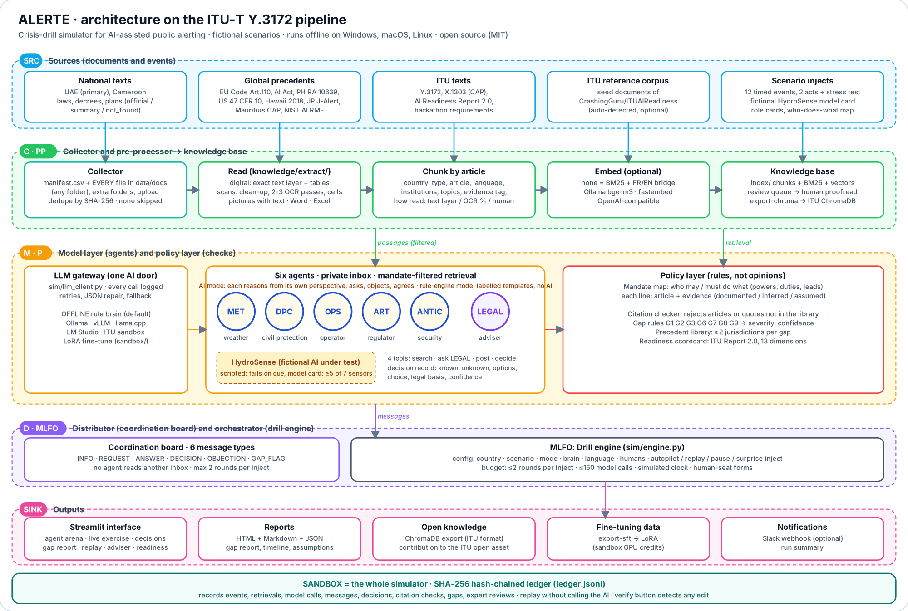

# ALERTE: a crisis-drill simulator for AI-assisted public alerting

> **Fictional exercise. Not a real alert.** ALERTE plays invented crisis stories. It never sends messages to real people.

ALERTE lets a country rehearse an AI-assisted crisis and find the holes in its rules before people get hurt.
AI agents play the institutions of the United Arab Emirates (and of Cameroon, as a second case) during a flood in which a
fictional AI warning system fails. Each agent sees only its own inbox and only the powers the law gives it. ALERTE
detects the gaps in the rules (nobody in charge, two in charge, no procedure, AI unchecked, people left out...),
shows how other countries solve each one, and records every step in a logbook that nobody can secretly change.

Built for the **ITU AI for Good Lab Hackathon (United Arab Emirates, 2026)** on top of the ITU reference code
([CrashingGuru/ITUAIReadiness](https://github.com/CrashingGuru/ITUAIReadiness), MIT). ALERTE lives in the `alerte/`
folder of our fork of that repository.



Full diagram and Y.3172 mapping: [docs/ARCHITECTURE.md](docs/ARCHITECTURE.md).

### What the interface shows

| Screen | What you see |
| --- | --- |
| 1 Live exercise | An **agent arena**: the five institution agents, the AI system under test and the Legal Adviser around the coordination board. Blue dashed arrows are events delivered, orange are requests, green accepted answers, red refusals, purple answers of the Legal Adviser; red badges are gap flags, green badges decisions. Next event, autoplay with a pause, look back at any event, human seats, surprise events. |
| 2 Decisions | Every decision with what the seat knew and did not know, the article it cites, and whether the quote was verified; filters by seat, event, missing basis, unverified quotes. |
| 3 Gap report | Gaps with severity, evidence, texts checked, global examples; expert review written to the logbook; the 13-dimension readiness table; assumptions. |
| 4 Replay and audit | Replay any event or any logbook entry without calling the AI again, see what each seat knew, and verify the hash chain. |
| More | Legal adviser, readiness and country comparison, knowledge base, architecture. |

### Do the agents think? (rule engine versus AI model)

Two modes, always labelled. **Rule engine** (`offline`): no AI; each institution's words are assembled from the who-does-what table with
fixed templates, so they look alike. **AI model** (`llm`): an open model writes each institution's decision and statement from its own
perspective, they answer each other's requests, and then discuss (agree, object, ask). Gap detection and citation checking are code in both
modes. See [docs/AGENTS.md](docs/AGENTS.md) for what is scripted, rule-based or AI, how to inspect every decision, and how to run a free model.

### Reading every document (scans, tables, mixed pages)

Every file under `data/docs/` (any subfolder, any name), under the folders in `ALERTE_EXTRA_DOC_DIRS`, and everything uploaded in
the interface is read and added to the knowledge base. Digital files give their exact text; scans go through clean-up and
multi-pass OCR (Tesseract 5, best-accuracy French, English and Arabic models, shipped in `ocr/tessdata`); ruled tables in scans are
read cell by cell; pictures with text inside PDFs and Word files are read too. Pages the OCR is not sure about are **flagged** and
can be proofread (`python -m alerte review <id>`); a file that cannot be read is reported with its reason, never skipped silently.
No OCR can guarantee 100% on every scan, so uncertain pages are surfaced instead of trusted. Details, measured accuracy and limits:
[docs/EXTRACTION.md](docs/EXTRACTION.md).

### Two profiles

- **core** (`ae-core`, `cm-core`): the hackathon submission. UAE first, Cameroon second. 12 events (Act 1 Dubai false alarm, Act 2
  Al Ain missed flood, then a stress test where the vendor offers to skip human validation), five institution agents
  (`MET`, `DPC`, `OPS`, `ART`, `ANTIC`), HydroSense under test, the Legal Adviser, and seven active gap rules (G1, G2, G3, G6, G7, G8, G9).
  Seats that find no legal basis consult the Legal Adviser (at most `ALERTE_LEGAL_CONSULT_MAX`, default 14, per drill).
- **extended** (`cm01`, `ae01`): the 15-event, three-act version with health and data-protection acts (G4, G5, G10).

---

## Quick start (Windows, macOS, Linux)

You need **Python 3.10 or newer** ([python.org](https://www.python.org/downloads/); on Windows tick *Add python.exe to PATH*).

**Windows (PowerShell)**

```powershell
cd alerte
powershell -ExecutionPolicy Bypass -File setup.ps1
.\.venv\Scripts\python.exe -m alerte ui
```

**macOS / Linux**

```bash
cd alerte
bash setup.sh
source .venv/bin/activate && python -m alerte ui
```

The browser opens on `http://localhost:8501`. No AI model, account or internet connection is needed: the default
**offline brain** plays the institutions with transparent rules. Plug in a free open AI model when you want richer answers (below).

Manual install, if you prefer: `python -m venv .venv`, activate it, `pip install -r requirements.txt`, then
`python -m alerte ingest` and `python -m alerte run ae-core`.

## Use a free, open AI model

1. Install [Ollama](https://ollama.com/download) and run `ollama pull qwen2.5:7b-instruct` (about 5 GB; 16 GB RAM recommended).
2. Copy `.env.example` to `.env` and set `ALERTE_BRAIN=llm`.
3. `python -m alerte doctor --check-llm`, then `python -m alerte run ae-core --brain llm`.

Any OpenAI-compatible server works the same way (vLLM, llama.cpp server, LM Studio, the ITU sandbox): set
`ALERTE_LLM_BASE_URL` and `ALERTE_LLM_MODEL`. If the model fails or answers badly on a step, ALERTE uses its offline
rules for that step and writes the failure in the logbook, so a drill always finishes.

For meaning-based search in French, English and Arabic: `ollama pull bge-m3`, set `ALERTE_EMBED=ollama`, and run
`python -m alerte ingest` again. Without it, ALERTE uses keyword search with a French-to-English bridge.

## Main commands

| Command | What it does |
| --- | --- |
| `python -m alerte doctor` | Checks your setup |
| `python -m alerte ocr-setup` | Check Tesseract and download the OCR language models |
| `python -m alerte extract FILE` / `review ID` / `ocr-eval` | Read one file with a page report / proofread a flagged document / measure OCR accuracy |
| `python -m alerte ingest` | Builds the knowledge index (ALERTE documents + the ITU reference corpus if found) |
| `python -m alerte fetch` | Downloads the official texts listed in `data/manifest.csv` |
| `python -m alerte scenarios` | Lists the crisis stories |
| `python -m alerte run ae-core` | Runs the UAE core drill on autopilot (`cm-core` = Cameroon, `cm01`/`ae01` = extended, `--lang fr`, `--brain llm`) |
| `python -m alerte ask "question" --country CM` | Asks the policy and legal adviser |
| `python -m alerte compare cm-core ae-core` | Compares two drills (twin countries, or before/after a change in the law) |
| `python -m alerte verify <run>` | Checks that a drill logbook was not changed |
| `python -m alerte eval --repeats 3` | Measures the quality targets T1, T2, T3, T5, T6 |
| `python -m alerte export-chroma` | Exports the knowledge base to ChromaDB in the ITU reference format |
| `python -m alerte export-sft` | Builds a fine-tuning dataset for the sandbox |
| `python -m alerte ui` | Opens the web interface |

Every drill writes a folder in `runs/`: `report.html` and `report.md` (gap report, decision timeline, scorecard,
assumptions), the JSON files behind them, and `ledger.jsonl` (the logbook). Recorded drills are included for
judges: `runs/demo-ae-core`, `runs/demo-cm-core`, `runs/demo-ae01`, `runs/demo-cm01`; they appear straight away on the Decisions, Gap report and Replay screens.

## How ALERTE answers the hackathon

| Hackathon requirement | Where it is in ALERTE |
| --- | --- |
| Knowledge base of country documents, built with the ITU reference code, vectorised | `alerte/knowledge/` (article-level chunking, ChromaDB export in the reference format, optional vectors); `data/manifest.csv` |
| Adhere to the country's published documents | Every decision cites a passage, checked by `alerte/sim/citations.py`; otherwise it must say "no legal basis found" |
| Agent: innovative AI solution | `HYDRO`, the fictional AI warning system under test (`data/docs/SCN/`) |
| Agent: policy and legal adviser | `alerte/sim/adviser.py` (four-part answers with sources and global examples) |
| Agent: institutional participant | Seats in `data/scenarios/roles/` (core: weather, civil protection, operator, regulator, cybersecurity; extended adds health, data protection, councils) |
| Multi-agent coordination, different information and mandates | Private inboxes, institution walls on search, coordination room with requests and answers (`alerte/sim/engine.py`) |
| Error scenarios released progressively, uneven information | `data/scenarios/*.yaml` (12 timed events in the core profile, 15 in the extended one, each to chosen seats only) |
| Audit logging and reasoning traces | `alerte/sim/ledger.py` (SHA-256 hash chain, every AI prompt and answer), replay in `alerte/analysis/replay.py` |
| Gap identification with global examples | `alerte/analysis/gaps.py` (rules G1 to G10 on the who-does-what map; the core profile activates G1, G2, G3, G6, G7, G8, G9), `alerte/analysis/precedents.py`, `data/precedents.yaml` |
| ITU-T Y.3172 and AI Readiness Framework | Mapping below; scorecard on the 13 dimensions in `alerte/analysis/scorecard.py` |
| Fine-tune with sandbox credits | `alerte/sft.py`, `sandbox/finetune_lora.py`, `sandbox/serve_vllm.sh` |

### Mapping to ITU-T Y.3172

| Y.3172 node | ALERTE |
| --- | --- |
| Source (SRC) | Official texts and summaries (`data/docs`), story events, simulated sensors |
| Collector (C) | `knowledge/fetch.py`, `knowledge/ingest.py`, the event dispatcher in `sim/engine.py` |
| Pre-processor (PP) | `knowledge/parse.py`, `knowledge/chunk.py` (article-level), metadata and evidence tags, embeddings |
| Model (M) | Seats through one AI door (`sim/brain.py`, `sim/llm_client.py`), HydroSense |
| Policy (P) | Who-does-what map (`knowledge/mandates.py`), quote checker, gap rules, golden rules |
| Distributor (D) | Coordination room and inboxes (`sim/engine.py`) |
| Sink | Web interface, reports, logbook, Slack summary |
| Orchestrator (MLFO) | `Drill` (rounds, model choice, fallback, control) |
| Sandbox | ALERTE itself: AI alerting is tested here before any real use |

## Folder map

```text
alerte/
  alerte/               the Python package
    knowledge/          parse, chunk, search (BM25 + optional vectors), mandates, fetch, ChromaDB export
    sim/                engine, seats' brains, AI client, quote checker, logbook, legal adviser
    analysis/           gaps, world examples, scorecard, reports, comparison, replay
    knowledge/extract/  reading of any file: PDF text layer, OCR, tables, pictures, Office files, proofreading tools
    ui/                 web interface: main.py, arena.py (agent arena SVG), architecture.py, pages/ (one file per screen)
    integrations/       Slack webhook
  data/
    manifest.csv        every document: id, title, link, reliability, institutions, topics
    docs/               team summaries (CM, AE, GL, ITU) and official texts once fetched (*/official/)
    mandates/           actions.yaml + who-does-what maps (cm_mandates.csv, ae_mandates.csv)
    scenarios/          crisis stories and role cards
    precedents.yaml     world examples per gap topic
    eval/questions.yaml test questions with known answers
    framework/          ITU AI Readiness dimensions (from the reference repo)
  docs/                 architecture diagram (SVG, PNG) and notes
  sandbox/              GPU / sandbox kit: notebook, fine-tuning, vLLM
  tests/                automated tests (pytest)
  runs/                 drill outputs (four demo runs are committed)
```

## The knowledge base, honestly

- Each document has a **reliability**: `official` (full official text), `summary` (team summary of a reliable
  source, with its link), `fictional` (story material), or `not_found` (listed, still to obtain).
- Each line of the who-does-what map is `documented`, `inferred`, or `assumed` (with who assumed it). The report lists
  every assumption.
- Several Cameroonian texts are not online (Law 2024/017, Law 86/016, Decrees 96/054, 98/031, 2005/124, the National
  Contingency Plan). They are listed in the manifest as `not_found`; drop the PDF into `data/docs/CM/official/`, set its
  `file` and `reliability=official` in the manifest, and run `python -m alerte ingest`.
- To confirm with experts: the operational status of Cameroon's data protection authority (APDP), the real procedure
  for public alerts, and the article numbers marked "to verify".

## Add a country, a story or a rule

- **Country:** add its documents to `data/manifest.csv`, a `xx_mandates.csv` in `data/mandates/`, and role cards in
  `data/scenarios/roles/xx.yaml`.
- **Story:** copy `data/scenarios/cm01_rising_waters.yaml`; each event lists `to`, `required_actions` and `expected_gaps`.
- **Gap rule or action:** `data/mandates/actions.yaml` and `alerte/analysis/gaps.py`.

## Tests and quality targets

`python -m pytest` runs about 60 tests (knowledge, logbook tampering, drills in English and French, human seats, the AI path
against a mock server, fallback when the model fails or is down, exports). GitHub Actions runs them on Windows, macOS
and Linux (`.github/workflows/alerte-ci.yml`).

| Target | Offline brain (current) |
| --- | --- |
| T1 retrieval: right document in the top 5 | 28 / 28 questions |
| T2 quotes verified | 100% |
| T3 planned gaps found | UAE core 14 / 14, Cameroon core 12 / 13 (see below) |
| T6 time for a full drill | under 1 second offline; depends on the model with `--brain llm` |

In the Cameroon core drill the planned Act 2 overlap gap (G2) is not found, on purpose: the texts we hold name a lead
(the Civil Protection Directorate) for the multi-sector response, so the engine does not invent an overlap.

Re-measure with your AI model: `python -m alerte eval --brain llm --repeats 3` (adds T5 stability).

## Slack

Set `ALERTE_SLACK_WEBHOOK_URL` in `.env` ([how to create an incoming webhook](https://api.slack.com/messaging/webhooks))
and every finished drill posts a short summary to your team channel. Only counts and gap titles are sent.

## Licence and credits

MIT. ALERTE builds on the ITU reference code by Vishnu Ram OV (MIT, see `LICENSE.ITU-reference`) and reuses its
AI Readiness Framework dimensions. Summaries cite their sources; official texts belong to their publishers.
