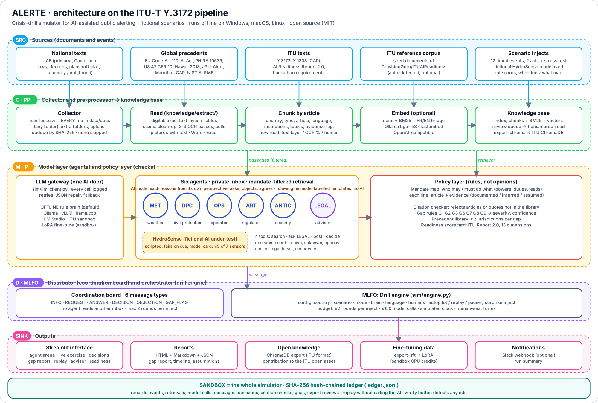

# ALERTE architecture

Vector version: [architecture.svg](architecture.svg) (also shown, and downloadable, on the **Architecture** page of the
interface). Regenerate with `python -m alerte.ui.architecture docs/architecture.svg`.

## Data flow in one picture

```mermaid
flowchart LR
  subgraph SRC[SRC: sources]
    D1[National texts UAE, CM]:::src
    D2[Global precedents]:::src
    D3[ITU texts]:::src
    D4[Scenario injects and role cards]:::src
  end
  subgraph CPP[C + PP: collect and prepare]
    M[manifest.csv + every file] --> F[ingest] --> P[extract: text layer, OCR, tables] --> CH[chunk by article] --> EM[embed optional] --> KB[(Knowledge base)]
  end
  subgraph MP[M + P: agents and checks]
    GW{{LLM gateway: offline rules or open model}}
    AG[MET DPC OPS ART ANTIC]
    LG[LEGAL adviser]
    HY[HydroSense scripted]
    POL[Mandate map, citation check, gap rules G1 G2 G3 G6 G7 G8 G9, precedents]
  end
  subgraph D[D: distributor]
    BR[[Coordination board and private inboxes]]
  end
  subgraph SINK
    UI[Streamlit: arena, decisions, gaps, replay]
    RP[Reports HTML MD JSON]
    EX[ChromaDB export, SFT data, Slack]
  end
  SRC --> CPP
  KB -- mandate-filtered passages --> AG
  KB --> LG
  GW --- AG
  GW --- LG
  HY -->|injects AI output| BR
  AG <--> BR
  AG -- "no legal basis found" --> LG
  LG -- answer + disclaimer --> BR
  BR --> POL --> SINK
  ENG((MLFO: Drill engine)) -.orchestrates.-> BR
  LED[(SHA-256 ledger)] -.records everything.-> ENG
  classDef src fill:#e0f2fe,stroke:#0ea5e9
```

## Y.3172 mapping

| Node | In ALERTE | Code |
| --- | --- | --- |
| SRC | National texts, global precedents, ITU texts, scenario injects, fictional HydroSense model card | `data/docs`, `data/scenarios` |
| C | Collects the manifest rows and every other file found in the document folders; event dispatcher on a simulated clock | `knowledge/ingest.py`, `knowledge/fetch.py`, `sim/engine.py` |
| PP | Reading of any file (text layer, OCR, tables, pictures), article-level chunking, metadata and evidence tags, optional embeddings | `knowledge/extract/`, `knowledge/chunk.py`, `knowledge/embed.py` |
| M | Six agents through one AI door; HydroSense scripted under test | `sim/brain.py`, `sim/llm_client.py`, `sim/adviser.py` |
| P | Mandate map, citation check, gap rules, precedents, readiness scorecard | `knowledge/mandates.py`, `sim/citations.py`, `analysis/` |
| D | Coordination board and private inboxes | `sim/engine.py` |
| SINK | Streamlit interface, reports, ChromaDB export, SFT data, Slack | `ui/`, `analysis/report.py`, `knowledge/chroma_export.py` |
| MLFO | Drill engine: rounds, model gateway with fallback, ledger | `sim/engine.py` |
| Sandbox | The whole simulator; hash-chained ledger; replay without AI | `sim/ledger.py`, `analysis/replay.py` |

## Gap rule labels: engine versus Technical Report v2

The engine keeps ten rules (G1 to G10). The core profile switches on seven (`gap_rules` in the scenario file). The
Technical Report v2 words two of them differently from the engine; both are covered, through the `gap_type` override
on an action in `data/mandates/actions.yaml`:

| Report v2 | Engine rule | Raised by action |
| --- | --- | --- |
| G1 nobody can oblige operators to relay | G1 Nobody is in charge | `compel_operator_alert` (no holder) |
| G2 overlapping mandates (who issues) | G2 Several bodies in charge, none leads | `decide_public_alert`, `coordinate_response` |
| G3 no check before an AI-drafted alert is released | G3 No procedure | `human_validate_ai_alert` (override to G3) |
| G6 no liability rule | G6 Liability unclear | `liability_alert_harm` |
| G7 language and reach | G7 People left out | `multilingual_alerting`, `reach_unconnected` |
| G8 AI used outside its validity | G8 AI unchecked | `validate_ai_forecast`, `report_sensor_outage`, `authorise_automatic_ai_alert` |
| G9 spoofing | G9 Spoofing | `block_spoofed_alert` |

If the report text and the engine label differ in your final submission, align the report to this table.
